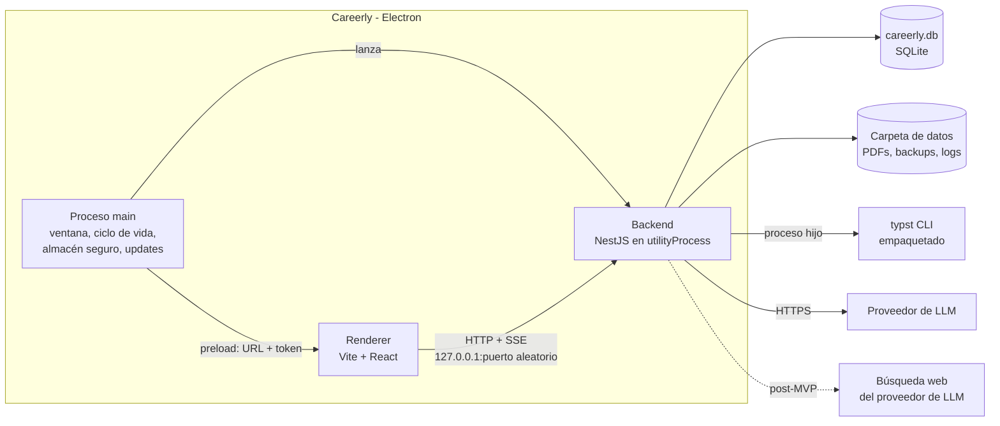
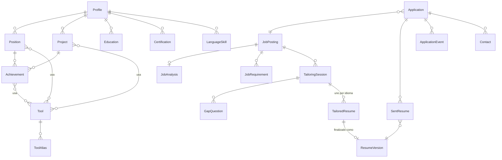
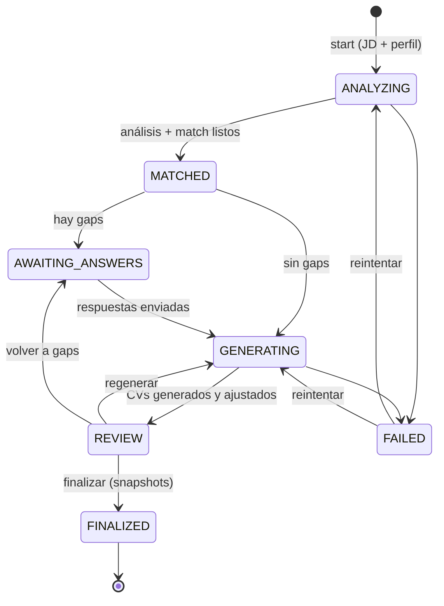
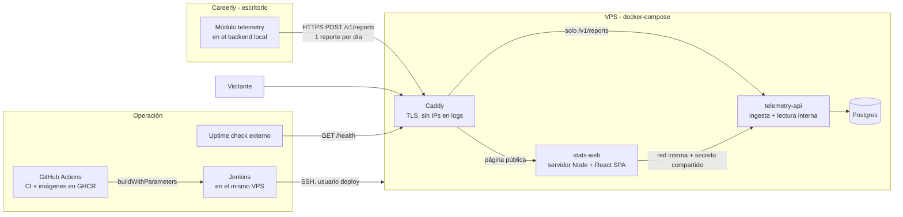

# Careerly — Arquitectura

> Estado: borrador v0.4 · Última actualización: 2026-11-16
> Documentos relacionados: [REQUIREMENTS.md](REQUIREMENTS.md) · [ROADMAP.md](ROADMAP.md)

## 1. Drivers de la arquitectura

Lo que más influye en las decisiones, en orden:

1. **App de escritorio personal, de un solo usuario y con datos locales.** Sin cuentas, sin servidor en la
   nube y sin infraestructura que operar. La única excepción es el receptor de telemetría (§19), que vive
   fuera de la app y nunca recibe datos del perfil.
2. **El flujo de adaptación tiene lógica de dominio real:** match, gaps, reglas de veracidad, ajuste a páginas
   y una máquina de estados de sesión. Tiene que poder testearse sin IA, sin base de datos y sin Typst.
3. **La IA es lenta, cara, falible y reemplazable.** Debe estar aislada detrás de una interfaz, ejecutarse en
   segundo plano y poder reemplazarse por un *fake* en tests.
4. **Inmutabilidad de lo enviado:** los snapshots se tienen que poder reproducir exactamente.
5. **Distribución simple:** instaladores para Windows (prioridad), macOS y Linux, y ejecución desde el código.

## 2. Decisiones principales

- **Electron** como contenedor de escritorio (ADR-12).
- **Monolito modular en NestJS** que corre localmente dentro de la app, con **arquitectura hexagonal solo en
  los módulos con lógica de dominio** (ADR-01).
- **SQLite** como base de datos, en un archivo dentro de la carpeta de datos del usuario (ADR-06).
- **Tareas largas en segundo plano dentro del mismo proceso**, con una cola persistida en SQLite: no hace
  falta Redis ni un worker aparte (ADR-15).
- **La interfaz habla con el backend por HTTP local** (`127.0.0.1`, puerto aleatorio, token por sesión), igual
  que una app cliente-servidor (ADR-13).

### ¿Por qué Electron y no Tauri?

| | Electron | Tauri |
|---|---|---|
| Backend | Node.js: **NestJS corre tal cual** | Rust. NestJS solo como *sidecar* (empaquetar Node aparte) |
| Tamaño del instalador | ~100 MB | ~10 MB |
| Madurez para auto-update, empaquetado y E2E | Muy alta (electron-builder, electron-updater, Playwright) | Buena, pero el sidecar de Node complica todo |

Tauri obligaría a reescribir el backend en Rust o a empaquetar Node como sidecar. Para un proyecto personal con
React + NestJS, el tamaño extra de Electron es un costo aceptable.

### ¿Por qué SQLite?

- Un solo usuario y un solo proceso escribiendo: el caso ideal de SQLite.
- Es un archivo: los backups son copiar un archivo (RF-CONF-04) y no hay servidor que instalar.
- Cubre lo que se usaba de PostgreSQL: columnas JSON (funciones JSON1), búsqueda de texto completo (FTS5) y, si
  hiciera falta, vectores para embeddings (`sqlite-vec`, ADR-08).

### Alternativas descartadas

| Alternativa | Por qué no |
|---|---|
| Mantener la versión web multiusuario | No es el objetivo (proyecto personal, D-01); agrega auth, hosting y costos. |
| Monolito en capas tradicional | La lógica de adaptación y la de IA quedarían acopladas a Nest, al ORM y al SDK del proveedor. |
| Hexagonal en todos los módulos | Burocracia innecesaria para módulos CRUD (contactos, datos personales). |
| IPC de Electron en lugar de HTTP local | Obliga a reemplazar los controllers de Nest y el streaming por SSE; HTTP permite además desarrollar la interfaz en el navegador. |

## 3. Procesos de la aplicación



| Proceso | Responsabilidad |
|---|---|
| **main** (Electron) | Crea la ventana, garantiza una sola instancia, lanza el backend con `utilityProcess.fork`, guarda las API keys de los proveedores de IA con `safeStorage`, gestiona actualizaciones (electron-updater) y abre enlaces externos en el navegador del sistema. |
| **preload** | Expone al renderer, vía `contextBridge`, solo lo mínimo: URL del backend, token de sesión y unas pocas acciones nativas (guardar o quitar una API key sin poder leerla, abrir la carpeta de datos, elegir archivo de backup). |
| **renderer** | La SPA de React. Sin acceso a Node (`contextIsolation`, `sandbox`, sin `nodeIntegration`). |
| **backend** (NestJS) | API HTTP, casos de uso, acceso a SQLite, cola de tareas en segundo plano, llamadas a la IA y render con Typst. |

### Arranque

```
1. main obtiene la carpeta de datos (app.getPath('userData')) y genera dos tokens aleatorios: el de la
   interfaz y el de control (solo main lo conoce)
2. main lanza el backend con: carpeta de datos y ambos tokens
3. backend: backup automático si hay migraciones pendientes → aplica migraciones → reanuda tareas pendientes
   → escucha en 127.0.0.1:0 (puerto libre) → informa el puerto a main
4. main descifra la API key del proveedor activo y se la envía al backend (solo en memoria)
5. main abre la ventana; el preload entrega URL + token de la interfaz al renderer
```

La key viaja de main al backend por `PUT /internal/ai-credentials` sobre loopback, autenticado con el token
de control; el token de la interfaz no sirve para esa ruta y no existe ninguna ruta que devuelva la key. Se usa
HTTP y no un mensaje del `utilityProcess` porque en `npm run dev` la API corre como un proceso aparte, sin canal
de mensajes: así hay un solo camino en desarrollo y en la app instalada. Si el usuario cambia la key o el
proveedor activo, main la vuelve a cifrar y se la envía al backend, sin reiniciar. En desarrollo main la reenvía
cada pocos segundos, porque la API en modo watch se reinicia y pierde lo que tenía en memoria.

### Modos de ejecución (RNF-18)

| Modo | Comando | Uso |
|---|---|---|
| Release instalada | Instalador desde GitHub Releases | Uso normal, con actualizaciones automáticas. |
| Desde el código | `npm install` + `npm start` | Compila todo y abre Electron, que lanza la API en un `utilityProcess`. Sin instalador ni auto-update. |
| Desarrollo | `npm run dev` | Vite con HMR + API en modo watch (proceso de Node aparte, puerto 4317) + Electron cargando la URL de Vite y conectándose a esa API. |
| Desarrollo solo en el navegador | `npm run dev:web` | API en modo watch + interfaz en el navegador (`localhost:5173`). Útil para depurar. |

En los modos de desarrollo la API usa un token fijo, no secreto, definido en los archivos
`.env.development`, y guarda los datos en `.data/` (ignorado por git).

### Carpeta de datos

```
<userData>/Careerly/
  careerly.db            # SQLite (modo WAL)
  files/
    snapshots/<id>.pdf   # PDFs de CVs finalizados (inmutables)
    guides/<id>.pdf      # guías de entrevista exportadas (post-MVP)
  backups/               # automáticos (previos a migraciones y a restaurar) + manual/*.careerly-backup
  logs/                  # logs rotativos, sin contenido sensible
  secrets.bin            # API keys por proveedor + proveedor activo, cifrado con safeStorage (solo main)
```

## 4. Módulos (bounded contexts)

```
settings ─────────────── (configuración, consumo de IA, backups)
profile      ◄── tailoring ──► job-postings
                    │
                    ├──► documents (render Typst, snapshots)
                    └──► ai (adaptadores de LLM)
applications ──► job-postings, documents (snapshots)
dashboard    ──► applications (solo lectura)
telemetry    ──► applications, job-postings, tailoring, ai (solo lectura) ──► receptor externo (§19)

post-MVP:
insights       ──► job-postings, profile, tailoring (solo lectura) ──► ai
interview-prep ──► applications, job-postings, documents, profile (solo lectura) ──► ai
```

| Módulo | Estilo | Responsabilidad |
|---|---|---|
| `settings` | Capas | Preferencias no secretas, consumo y presupuesto de IA, backup/restauración, borrado de datos. |
| `profile` | Capas + dominio ligero | Perfil maestro: experiencias, logros, proyectos, educación, certificaciones, idiomas, catálogo de herramientas. Registra el origen de cada elemento y permite revertir cambios por sesión. |
| `job-postings` | Capas | JDs y su análisis estructurado. |
| `tailoring` | **Hexagonal** | Sesión de adaptación: match, gaps, generación, ajuste a páginas, revisión y finalización. |
| `documents` | **Hexagonal** | Plantillas, render con Typst, conteo de páginas, snapshots inmutables y archivos PDF. |
| `applications` | **Hexagonal** | Postulaciones, máquina de estados, línea de tiempo, contactos, entrevistas. |
| `ai` | Infraestructura | Adaptadores de LLM, prompts versionados, salida estructurada, registro de uso y costo. |
| `jobs` | Infraestructura | Cola de tareas persistida en SQLite y su ejecutor (ver §10). |
| `dashboard` | Lectura | Consultas agregadas (sin dominio propio). |
| `telemetry` | Capas | Consentimiento por métrica, ID anónimo, armado del reporte diario con esquema cerrado, envío e historial local (ver §19). |
| `insights` *(post-MVP)* | Dominio ligero | Gaps recurrentes entre JDs y recomendaciones de capacitación (ver §18.1). |
| `interview-prep` *(post-MVP)* | **Hexagonal** | Research de empresas, guías de entrevista por etapa, debriefs (ver §18.2). |

**Reglas de dependencia (verificadas con ESLint, p. ej. `eslint-plugin-boundaries`):**

- Un módulo no accede a las tablas ni a los repositorios de otro módulo; usa su servicio de aplicación público.
- `domain/` no importa nada de NestJS, Drizzle, el SDK del LLM ni APIs de Node con E/S.
- `application/` depende solo de `domain/` y de los puertos que define.
- Solo `infrastructure/` y `http/` conocen frameworks y librerías externas.
- El backend no importa nada de Electron: recibe todo lo que necesita (carpeta de datos, token, API key) por
  configuración. Así se puede ejecutar y testear fuera de Electron.

## 5. Anatomía de un módulo hexagonal

```
apps/api/src/modules/tailoring/
  domain/
    tailoring-session.ts        # agregado + máquina de estados
    match.ts                    # Requirement, MatchResult (cubierto/parcial/faltante)
    gap.ts                      # GapQuestion, GapAnswer
    page-fitter.ts              # algoritmo de ajuste (puro)
    veracity-guard.ts           # RN-01, RN-02 (puro)
    ports/
      requirement-matcher.port.ts
      resume-writer.port.ts     # "redactá estos bullets" → salida estructurada
      resume-renderer.port.ts   # datos → PDF + cantidad de páginas
      profile-reader.port.ts    # lectura del perfil maestro
      profile-writer.port.ts    # alta de afirmaciones desde gaps
      session-repository.port.ts
  application/
    start-session.use-case.ts
    answer-gaps.use-case.ts
    generate-resumes.use-case.ts
    edit-resume.use-case.ts
    finalize-session.use-case.ts
    revert-profile-changes.use-case.ts
  infrastructure/
    drizzle-session.repository.ts
    llm-resume-writer.adapter.ts
    llm-requirement-matcher.adapter.ts
    profile-module.adapter.ts   # implementa ProfileReader/Writer usando el módulo profile
    documents-module.adapter.ts # implementa ResumeRenderer usando el módulo documents
  http/
    tailoring.controller.ts
    dto/
  tailoring.module.ts           # wiring de puertos → adaptadores (DI de Nest)
```

En los tests, cada puerto tiene un adaptador *fake* en memoria. Los casos de uso se testean completos sin red,
sin base de datos y sin Typst.

## 6. Modelo de datos (resumen)

Al haber un solo usuario, **no hay tabla de usuarios ni columnas `userId`**. El perfil maestro es único.



Tablas de soporte sin relaciones de dominio: `AiGeneration`, `Job` (cola), `Setting`, `TelemetryReport`.

### Entidades clave

| Entidad | Campos importantes | Notas |
|---|---|---|
| `Profile` | datos personales, titular, links | Fila única. |
| `Position` | company, title, startDate, endDate?, location, workMode, context | Experiencia laboral. |
| `Project` | name, kind (`PERSONAL`, `OPEN_SOURCE`, `COURSE`, `FREELANCE`), url?, dates, description | Misma forma que `Position` a efectos de logros. |
| `Achievement` | text, metrics?, toolIds[], origin, originSessionId? | Unidad mínima. Puede ser muy detallado: es material de base, no texto final. |
| `Tool` | canonicalName, category, isCustom | Catálogo inicial incluido en la app (*seed*) + herramientas creadas por el usuario. |
| `ToolAlias` | alias → toolId | Resuelve sinónimos ("Postgres" → PostgreSQL). |
| `JobAnalysis` | language, roleCategory, seniority, workMode, country, yearsOfExperience, keywords, promptVersion, model, editedAt | Salida validada de la IA, una por JD (se reemplaza al volver a analizar). El usuario puede corregirla (RF-JD-03): `editedAt` marca que hubo correcciones, que pasan por la misma normalización. No se corrige mientras hay un análisis en curso (409). Los requisitos viven en `JobRequirement`. |
| `JobRequirement` | jobPostingId, position, label, kind, importance, toolId?, toolName? | Requisitos normalizados para poder agregarlos entre JDs (ADR-09, §18.1). `toolId` apunta al catálogo de `profile` sin clave foránea. |
| `TailoringSession` | status, jobPostingId, languages[], pageBudget, templateId, matchResult (JSON) | Agregado principal del módulo `tailoring`. |
| `GapQuestion` | requirement, kind (`MISSING`, `PARTIAL`), relatedEvidence, answer (`USED_AT_WORK`, `USED_ELSEWHERE`, `NOT_USED`, `SKIPPED`), answerDetail, includeInResume, createdEntityIds[] | El "No" vive **solo acá**, nunca en el perfil (RN-11, RN-12). |
| `TailoredResume` | sessionId, language, data (JSON), pageCount, fitLog | Editable hasta finalizar. Cada bullet guarda `sourceIds[]`, `score` y `editedByUser`. |
| `ResumeVersion` | data (JSON), language, templateId, templateVersion, pdfPath, pageCount, contentHash, createdAt | **Inmutable.** Sin `UPDATE` en el repositorio. |
| `Application` | jobPostingId, status, channel, priority, salaryExpected?, salaryOffered?, appliedAt? | |
| `SentResume` | applicationId, resumeVersionId, sentAt | Permite varios CVs enviados (p. ej. ES y EN). |
| `ApplicationEvent` | type (`STATUS_CHANGE`, `NOTE`, `INTERVIEW`, `MESSAGE`), payload (JSON), occurredAt | Línea de tiempo, *append-only*. |
| `AiGeneration` | task, model, promptVersion, inputTokens, outputTokens, costUsd, latencyMs, status | Base del consumo y presupuesto (RF-CONF-06, RF-CONF-07). |
| `Setting` | key, value (JSON) | Preferencias no secretas. La API key **no** se guarda acá. Incluye las preferencias de telemetría: `installId`, métricas activadas y `consentVersion`. |
| `TelemetryReport` | day, payload (JSON), status (`PENDING`, `SENT`, `FAILED`), attempts, sentAt? | Historial local de lo enviado, tal cual salió (RF-TEL-06). |

**Origen y reversión en el perfil (RF-PROF-07, RF-TAIL-06):** todo elemento creado desde un gap guarda
`origin = GAP_ANSWER` y `originSessionId`. "Deshacer" borra esos elementos (o restaura el texto anterior, si se
modificó uno existente, para lo cual se guarda un registro de cambios mínimo por sesión).
Implementado en el paso 2.6: la tabla `profile_changes` guarda cada alta (`CREATE`) y cada cambio (`UPDATE`,
solo con los campos tocados, su valor anterior y el nuevo). `ProfileChangesService`, la API pública del
módulo `profile` para `tailoring`, escribe desde los gaps y deshace la sesión entera o cambio por cambio. La
función pura `planRevert` decide qué hacer: borra lo creado (lo más nuevo primero) y devuelve cada campo a su
valor anterior, salvo que el usuario lo haya editado después de la sesión: en ese caso se respeta la edición.

**Columnas JSON:** en SQLite se guardan como `TEXT`, se validan con Zod al leer y escribir, y se consultan con
las funciones JSON1 cuando hace falta.

## 7. Pipeline de adaptación

### 7.1 Máquina de estados de la sesión



### 7.2 Pasos

| # | Paso | Tipo |
|---|---|---|
| 1 | **Análisis de JD:** extraer requisitos estructurados. | LLM (modelo chico/rápido) + validación Zod |
| 2 | **Normalización:** mapear herramientas de la JD al catálogo (alias, minúsculas, variantes). | Determinístico |
| 3 | **Match determinístico:** requisitos de herramientas vs. herramientas del perfil. | Determinístico |
| 4 | **Match semántico:** requisitos no-herramienta ("liderar equipos") vs. logros. Devuelve evidencia por id. | LLM + validación de que los ids existen |
| 5 | **Gaps:** generar preguntas para lo faltante o parcial. | Determinístico (plantillas de preguntas, no LLM) |
| 6 | **Respuestas:** aplicar respuestas afirmativas al perfil (vía puerto `ProfileWriter`). | Determinístico |
| 7 | **Puntuación:** relevancia de cada logro/proyecto frente a la JD (0–1). | LLM (o embeddings, ADR-08) |
| 8 | **Redacción:** bullets y resumen en el idioma pedido, con `sourceIds`. | LLM (modelo grande) + salida estructurada |
| 9 | **Guardia de veracidad:** RN-01, RN-02, RN-03. Bullets inválidos se descartan o se regeneran (máx. 1 reintento). | Determinístico |
| 10 | **Ajuste de páginas** (ver §8). | Determinístico + Typst |
| 11 | **Revisión y finalización:** snapshot por idioma. | Determinístico |

Los pasos con LLM se ejecutan como tareas en segundo plano (§10).

**Por qué dividirlo en pasos y no hacer "un gran prompt":** cada paso es testeable, se puede reintentar por
separado, permite modelos distintos según la tarea (costo) y deja puntos donde validar en código lo que
devolvió la IA.

### 7.3 IA: proveedor, prompts y salidas

- **Puerto `LlmClient`** en el módulo `ai` con operaciones tipadas: `extractRequirements`, `matchEvidence`,
  `scoreRelevance`, `writeResume`. Cada una recibe y devuelve tipos de dominio; el adaptador arma el prompt.
- **Proveedores (ADR-23):** varios, con la **API key del usuario** para cada uno y uno activo a la vez. Primer
  adaptador: **Google Gemini**; luego **Claude (Anthropic)**, con el SDK oficial; OpenAI queda abierto. Cada
  adaptador implementa todo `LlmClient`, y el dominio no sabe cuál está activo. Modelo grande para la redacción
  (paso 8) y modelo chico para extracción y puntuación (pasos 1, 4, 7). Cada nivel es una **lista de modelos en
  orden de preferencia** (valores por defecto en código, configurables por entorno): si un modelo fue retirado
  (404) o está sobrecargado (503), `LlmClient` pasa al siguiente y registra cada intento. El usuario puede elegir
  el modelo de cada nivel en Configuración (RF-CONF-09, paso 4.10): la lista sale de la API del proveedor y se
  cruza con un catálogo en código (precio, nivel recomendado, probado con salida estructurada). La elección se
  guarda en `settings` (`ai.models.<proveedor>.<nivel>`), va primero y los valores por defecto quedan como
  alternativas, así que un modelo retirado no rompe nada. Los proveedores retiran modelos seguido (en noviembre de 2026 la familia Gemini 2.5 ya no sirve
  para keys nuevas), así que los valores por defecto se revisan con `GET /internal/ai/models` y
  `POST /internal/ai/smoke`. Los prompts son los mismos; si un proveedor necesita ajustes, el adaptador los aplica
  sin cambiar la versión del prompt. Los evals (paso 4.7) se corren con cada proveedor soportado.
- **Claude Code local (ADR-25, opcional):** en lugar de una API key, el proveedor `claude-code` usa el `claude`
  instalado y logueado en la computadora (`claude -p --output-format json --json-schema …`), con el plan de
  Claude del usuario. Es experimental y solo para uso personal: Anthropic no permite que apps de terceros
  ofrezcan el login de claude.ai sin aprobación, así que nunca es el valor por defecto. Se activa con un
  interruptor en Configuración (`ai.claudeCode.enabled`, solo si `claude auth status` dice que hay sesión) y,
  mientras está activo, `ActiveAiCredentials` lo elige en cada llamada en lugar de la key que manda Electron.
  Como Claude Code es un agente y el CV o la JD son contenido no confiable, cada llamada corre aislada: carpeta
  temporal propia como directorio de trabajo (se borra al terminar), sin herramientas salvo `Read(./**)` sobre
  los PDF copiados ahí, `--permission-mode dontAsk`, sin MCP (`--strict-mcp-config`), sin la configuración del
  usuario (`--setting-sources ""`), sin guardar la sesión y sin variables `ANTHROPIC_*` ni `CAREERLY_*` en su
  entorno (factura la suscripción y nunca ve los tokens de la app). El prompt va por stdin, sin shell. Los
  tokens se registran en `AiGeneration` sin costo (los paga el plan).
- **Salida estructurada:** *tool use* / JSON schema del proveedor + validación con Zod. Si no valida, un
  reintento con el error; si vuelve a fallar, el paso queda en `FAILED`.
- **Prompts versionados** como archivos en el repo (`ai/prompts/*.v3.md`). `promptVersion` se guarda en
  `AiGeneration` y en `JobAnalysis`.
- **Prompt injection:** el texto de la JD va delimitado y declarado como dato no confiable; la IA nunca recibe
  herramientas con efectos (solo devuelve JSON); la guardia de veracidad impide que una JD "inyecte"
  experiencia en el CV.
- **Prompt caching:** el perfil maestro es el bloque grande y estable de cada sesión; se ubica primero en el
  prompt para aprovechar el caché del proveedor.
- **Costos:** cada llamada registra tokens y costo en `AiGeneration`. Si el usuario configuró un presupuesto
  mensual (RF-CONF-07), se verifica antes de encolar la tarea.
- **Sin conexión:** si no hay red o la API key no es válida, las acciones de IA se deshabilitan con un mensaje
  claro y el resto de la app sigue funcionando (RNF-13).

## 8. Ajuste a 1–2 páginas

El LLM no puede medir páginas, así que el ajuste es **determinístico** y usa Typst como "regla":

```
entrada: candidatos (bullets con score), presupuesto de páginas, reglas de sección
1. Armar el CV con reglas iniciales:
     - puesto actual/más reciente: hasta 5 bullets
     - puestos de los últimos ~10 años: hasta 3 bullets
     - puestos más antiguos: solo empresa, rol y fechas
     - proyectos: solo si el usuario los marcó como relevantes o cubren un requisito
2. Renderizar con Typst → contar páginas
3. Mientras páginas > presupuesto:
     quitar el bullet de menor score (respetando un mínimo de 1 bullet por puesto reciente)
     re-renderizar
4. Si sobra mucho espacio (< 85 % de la última página) y hay candidatos descartados:
     agregar el de mayor score y verificar que siga entrando
5. Guardar fitLog (qué se quitó y por qué) → visible para el usuario en la revisión
```

- Typst compila un CV en milisegundos, por lo que 10–20 iteraciones son aceptables.
- **Conteo de páginas (ADR-07):** se cuenta en el PDF resultante (pdf-lib), no con `typst query`. Funciona con
  cualquier plantilla, incluidas las propias, sin pedirles metadata; no compila dos veces y cuenta exactamente
  lo que recibe el usuario. Cada render devuelve el PDF y su `pageCount`.
- `page-fitter.ts` (`tailoring/domain`) es puro: recibe una función `measure(selección) → pageCount` (el
  puerto), así que se testea con un medidor falso.
  - Los puestos viejos y los proyectos no relevantes no se rellenan nunca.
  - Si quitar no alcanza (queda un bullet por puesto reciente), devuelve `fits: false` (RN-04).
  - Las reglas son configurables y hay un tope de 30 mediciones (RNF-08).
  - El `fitLog` dice qué quedó afuera y por qué (`OLD_POSITION`, `SECTION_LIMIT`, `NOT_RELEVANT`,
    `OVER_BUDGET`) y qué se agregó para llenar (`SPACE_LEFT`).
- **Relleno sin medir el espacio libre:** como `measure` solo devuelve páginas, el paso 4 agrega a los
  candidatos descartados de mayor score mientras el CV siga entrando, en vez de usar el umbral del 85 %.
  Medir cuánto se llena la última página se puede sumar más adelante si los CVs quedan demasiado cargados.

## 9. Render con Typst (módulo `documents`)

```
apps/api/templates/       # plantillas incluidas; contrato en apps/api/templates/README.md
  classic/
    template.typ          # lee los datos con json(sys.inputs.at("data", default: "data.json"))
    template.json         # id, nombre, versión
  examples/               # TemplateData de ejemplo por idioma; prueban cualquier plantilla
  fonts/                  # fuentes disponibles para todas las plantillas (licencia OFL)
```

- **Plantillas incluidas y propias (ADR-24):** `classic` viene con la app y es la plantilla por defecto. El
  usuario puede subir su propia plantilla `.typ`, que sigue el mismo contrato: recibe un único JSON
  (`TemplateData`: el `ResumeDocument` más `labels`, los textos fijos en el idioma del CV) y no necesita
  traducciones propias. Al subirla se valida renderizando los ejemplos de cada idioma; se guarda en el directorio
  de datos (`files/templates/<id>/<versión>/`) con versión propia, como las incluidas.

- **Binario empaquetado (ADR-14):** el CLI de `typst` se incluye en el instalador por plataforma
  (`resources/typst/`, con su LICENSE y NOTICE), con versión fija y checksum verificado por
  `scripts/fetch-typst.mjs`. Se descarta el compilador como módulo nativo de Node: un proceso hijo se puede matar
  por timeout (clave con plantillas subidas por el usuario), no bloquea el backend, usa la versión oficial de
  Typst y no requiere recompilar nada para Electron. El empaquetado termina renderizando `classic` con el binario
  y las plantillas del instalador, sin nada del sistema.
- **Datos, no código:** el adaptador escribe `data.json` en un directorio temporal y la plantilla lo lee. El
  contenido del usuario nunca se concatena dentro de un `.typ` (RNF-05).
- **Ejecución aislada:** `typst compile` como proceso hijo (no bloquea el backend). Cada render copia la
  plantilla y escribe `data.json` en un directorio temporal, que es el `--root`, así que la plantilla no puede
  leer otros archivos. Usa solo las fuentes empaquetadas (`--ignore-system-fonts`), tiene un timeout de 10 s
  (`CAREERLY_RENDER_TIMEOUT_MS`) y el directorio temporal se elimina al terminar. Los paquetes de Typst
  (`@preview/...`) van a `cache/typst-packages/` dentro del directorio de datos, nunca a carpetas del sistema.
  Si se permiten en las plantillas propias se decide en la 4.12.
- **Puerto `ResumeRenderer` y catálogo de plantillas:** `ResumeRenderService.render(document, templateId)`
  agrega los `labels` del idioma, busca la plantilla (por defecto `classic`) y devuelve el PDF con el id y la
  versión de la plantilla. Los errores son `TemplateNotFoundError` y `RenderError`, que puede ser
  `RENDERER_UNAVAILABLE`, `COMPILE_ERROR` (con el diagnóstico de Typst para quien escribió la plantilla, nunca a
  los logs) o `TIMEOUT`.
- **Versionado de plantillas:** cada cambio de plantilla incrementa `templateVersion`. Los snapshots guardan la
  versión; las versiones viejas se conservan en la app para poder volver a renderizar (RNF-10).
- **Plantillas compatibles con ATS:** una columna, títulos estándar traducidos por idioma, sin tablas para el
  diseño, sin texto en imágenes y fuentes embebidas. Es una guía para las plantillas propias: la app no puede
  verificarlo del todo y lo indica al subirlas.
- **Vista previa:** endpoint que renderiza el `TailoredResume` actual y devuelve el PDF; el renderer lo muestra
  con el visor de PDF de Chromium integrado en Electron.
- **Snapshots:** al finalizar se renderiza, se calcula `contentHash` (datos + plantilla + versión), se guarda el
  PDF en `files/snapshots/` y se crea `ResumeVersion` en una transacción. Los archivos de snapshots son de solo
  lectura para la app.

## 10. Tareas en segundo plano (módulo `jobs`)

Sin Redis ni worker aparte: las tareas largas corren en el mismo proceso del backend, que de todos modos pasa
la mayor parte del tiempo esperando respuestas de red (LLM) o procesos hijos (Typst).

- **Cola persistida:** tabla `jobs` (id, type, payload, dedupeKey, status, attempts, maxAttempts, runAt,
  lastError). Encolar una tarea (`JobQueue.enqueue`, sincrónico) es un `INSERT` en la misma transacción que el
  cambio de estado de la sesión. El payload lleva solo ids: el handler lee el contenido de su módulo. `lastError`
  guarda el código del error, nunca su mensaje. Volver a encolar con la misma `dedupeKey` devuelve la misma
  tarea; si había fallado, vuelve a `PENDING`.
- **Ejecutor (`JobRunner`):** cada módulo registra un handler por tipo de tarea. Corre hasta 2 tareas a la vez
  y reintenta con *backoff* exponencial: 2 s, 4 s, 8 s… (`CAREERLY_JOB_RETRY_BASE_MS`), con tope de 5 min y
  3 intentos por defecto. Un `PermanentJobError` corta los reintentos. Las tareas son idempotentes por
  `dedupeKey` (`sessionId + step`).
- **Reanudación:** al iniciar la app, las tareas que quedaron `RUNNING` (porque se cerró la app) vuelven a
  `PENDING` y se reintentan (RNF-13). Al cerrar, el resultado de los intentos que siguen en curso no se escribe.
- **Progreso:** el ejecutor emite eventos en memoria (`started`, `progress`, `retrying`, `succeeded`, `failed`)
  que el backend reenvía a la interfaz por **SSE**. `GET /jobs/:id/events` manda primero el estado y termina
  cuando la tarea termina; `GET /tailoring-sessions/:id/events` los agrupará por sesión. Si la interfaz se recarga,
  consulta el estado persistido (`GET /jobs/:id`).
  `EventSource` no permite mandar headers, así que la interfaz lee el SSE con `fetch` (stream) y el mismo
  `Authorization: Bearer <token>` que el resto de la API: no hace falta un token en la URL.

## 11. API local (resumen)

REST sobre `http://127.0.0.1:<puerto>`, JSON y validación con esquemas Zod compartidos (`packages/contracts`).
Todas las rutas exigen el token de sesión (RNF-19).

```
GET    /settings | PATCH /settings
GET    /ai/usage?month=YYYY-MM                     # consumo de IA: total del mes, por día y por tarea, y los 12 meses hasta ese (hora local)
GET    /jobs/:id                                   # estado de una tarea en segundo plano (+ progreso si está corriendo)
GET    /jobs/:id/events                            # SSE: estado actual y eventos hasta que termina
GET    /ai/status                                  # configurada (key o Claude Code) y si el proveedor rechazó la key desde que cambió
POST   /settings/ai-key/verify                     # prueba la key activa en memoria o una candidata { provider, apiKey }; nunca la guarda
GET    /settings/ai-models                         # modelos que la key puede usar + catálogo (precio, recomendado, probado) + elección por nivel
PUT    /settings/ai-models                         # { tier, model | null }: prueba el modelo con una llamada mínima y lo guarda; null = por defecto
GET    /backups | POST /backups | POST /backups/restore   # archivo único .careerly-backup (SQLite: base + PDFs)
DELETE /data                                # body { confirmation: "DELETE_ALL_DATA" }

GET    /profile
PATCH  /profile/personal-info
CRUD   /profile/positions, /profile/positions/:id/achievements
POST   /profile/achievements/suggestions          # sugerencia de redacción de un logro (no guarda nada; descarta las que agregan números)
CRUD   /profile/projects, /profile/education, /profile/certifications, /profile/languages
GET    /tools?query=                               # catálogo con alias

GET    /templates | POST /templates                # incluidas + propias; subir un .typ (multipart) lo valida con los ejemplos
PATCH  /templates/:id | DELETE /templates/:id      # solo las propias; no se borra una usada por un snapshot
GET    /templates/:id/preview/:lang                # PDF de la plantilla con el ejemplo de ese idioma
GET    /templates/starter-kit                      # .zip con classic y los ejemplos, para escribir una propia

CRUD   /job-postings
POST   /job-postings/:id/analyze                   # encola el análisis (tarea `jd-analysis`, una por JD; volver a pedirlo la reinicia) y devuelve la tarea
GET    /job-postings/:id/analysis                  # último análisis + estado de la tarea
PATCH  /job-postings/:id/analysis                  # correcciones del usuario

POST   /tailoring-sessions                         # { jobPostingId, languages[], pageBudget, templateId }
GET    /tailoring-sessions/:id
GET    /tailoring-sessions/:id/events              # SSE
GET    /tailoring-sessions/:id/gaps
PUT    /tailoring-sessions/:id/gaps                # respuestas
POST   /tailoring-sessions/:id/generate
PATCH  /tailoring-sessions/:id/resumes/:lang       # ediciones
GET    /tailoring-sessions/:id/resumes/:lang/preview
POST   /tailoring-sessions/:id/finalize
POST   /tailoring-sessions/:id/revert-profile-changes

GET    /resume-versions/:id
GET    /resume-versions/:id/pdf

CRUD   /applications
POST   /applications/:id/status                    # transición validada por el dominio
POST   /applications/:id/sent-resumes
CRUD   /applications/:id/events, /applications/:id/contacts

GET    /dashboard/summary

GET    /telemetry/settings | PATCH /telemetry/settings   # métricas activadas, consentimiento
GET    /telemetry/preview                          # JSON exacto del próximo envío
GET    /telemetry/reports                          # historial local de envíos
POST   /telemetry/install-id/regenerate
```

## 12. Interfaz (renderer)

- **Vite + React + TypeScript.**
- **Routing:** React Router en modo *hash* (compatible con cargar la app desde archivos locales en producción).
- **Datos del backend:** TanStack Query. Sin store global salvo para estado de UI puntual.
- **Formularios:** React Hook Form + resolvers de Zod usando `packages/contracts`.
- **UI:** librería de componentes accesibles (p. ej. shadcn/ui sobre Radix + Tailwind). Kanban con `dnd-kit`.
- **i18n de la interfaz:** `react-i18next` (ES y EN).
- **Puente con Electron:** un único módulo `shared/desktop.ts` lee lo expuesto por el preload; en modo
  `dev:web` usa valores de desarrollo. El resto de la interfaz no sabe si corre en Electron o en el navegador.
- **Organización por *feature*:**

```
apps/web/src/
  features/
    settings/  profile/  job-postings/  tailoring/  applications/  dashboard/
      api/          # hooks de TanStack Query
      components/
      pages/
  shared/           # UI base, layout, cliente HTTP, puente con Electron
```

- **Primer inicio:** asistente para configurar la API key (RF-CONF-01) y el idioma de la interfaz.
- **Flujo de adaptación como *wizard*:** JD → análisis → gaps → opciones (idiomas, páginas, plantilla) →
  generación con progreso → revisión con vista previa en paralelo → finalizar → crear o vincular postulación.

## 13. Monorepo y herramientas

```
careerly/
  apps/
    desktop/             # Electron: main + preload, configuración de electron-builder
    web/                 # Vite + React (renderer)
    api/                 # NestJS (backend local)
    telemetry-api/       # receptor de telemetría (NestJS + Postgres), corre en el VPS (§19)
    stats-web/           # página pública de estadísticas: React (Vite) + servidor Node intermediario (§19)
  packages/
    contracts/           # esquemas Zod + tipos compartidos (DTOs, enums de estado, reporte de telemetría)
  infra/
    telemetry/           # docker-compose (staging y prod), Caddyfile y backups del receptor
    jenkins/             # Jenkins como código: plugins.txt, JCasC y Jenkinsfile de deploy
    eslint-config/
    tsconfig/
  scripts/
    fetch-typst.mjs      # descarga el binario de typst por plataforma (versión + checksum) a vendor/typst/
  REQUIREMENTS.md  ARCHITECTURE.md  ROADMAP.md
  release-please-config.json  .release-please-manifest.json   # versionado (§16.1)
```

- **npm workspaces** (+ Turborepo si los tiempos de build lo justifican). Todo el monorepo es ESM.
- **TypeScript 5.9** (typescript-eslint todavía no soporta TypeScript 7).
- **Base de datos:** SQLite con el módulo integrado **`node:sqlite`** + **Drizzle ORM** a través de su driver
  `sqlite-proxy` (Drizzle no tiene un driver para `node:sqlite`); migraciones generadas con `drizzle-kit`,
  incluidas en la app y aplicadas al iniciar por un migrador propio que hace el backup previo (ADR-06). Al no
  haber módulo nativo, no hay nada que recompilar para Electron. Las transacciones usan `inTransaction()`, porque
  el driver proxy no soporta `db.transaction()`.
- **Empaquetado del backend:** se compila con `tsc` (emite la metadata de decoradores que necesita la inyección
  de dependencias de Nest) y main lo ejecuta con `utilityProcess.fork`. Cómo se incluye en el instalador se
  define en la Fase 1.4.
- **Tests:** Vitest con proyectos por paquete; la API usa SWC (`unplugin-swc`) para emitir la metadata de
  decoradores.
- **Límites entre módulos:** `eslint-plugin-boundaries` (con `eslint-import-resolver-typescript`) para las capas
  y módulos de la API, y `no-restricted-imports` para prohibir frameworks e I/O en `domain/`, Electron en la API
  y Node/Electron en la interfaz.
- **Calidad:** ESLint + Prettier, `tsc --noEmit` y tests en CI (GitHub Actions) en cada PR.

## 14. Seguridad y privacidad

- **API local protegida (RNF-19):** escucha solo en `127.0.0.1`; token aleatorio por ejecución, enviado en cada
  petición (`Authorization: Bearer`); verificación de los encabezados `Host` y `Origin` para evitar ataques
  desde sitios web (CSRF, *DNS rebinding*); CORS restringido al origen de la app.
- **Endurecimiento de Electron:** `contextIsolation`, `sandbox`, sin `nodeIntegration`, *Content Security
  Policy* estricta, sin carga de contenido remoto en la ventana, navegación bloqueada fuera de la app y enlaces
  externos abiertos en el navegador del sistema (solo `http`/`https`).
- **API keys:** cifradas con `safeStorage` (usa el almacén del sistema operativo: DPAPI en Windows, Keychain en
  macOS, libsecret en Linux). Si el sistema no ofrece un almacén seguro (p. ej. Linux sin llavero, donde
  Electron usaría una clave fija), la app se niega a guardar la key en vez de guardarla sin protección. Solo main
  la descifra y se la pasa al backend en memoria; el renderer puede guardarla o quitarla pero nunca leerla; nunca
  se escribe en la base, en logs ni en backups.
- **Contenido generado:** las salidas de la IA nunca se renderizan como HTML sin sanitizar.
- **Logs:** locales, rotativos, sin contenido del perfil, JDs ni prompts (RNF-02).
- **Backups:** el archivo exportado contiene datos personales; la app lo advierte al exportar. (Cifrado opcional
  con contraseña: post-MVP.)
- **Proveedor de IA:** documentar qué datos se envían y la política de retención de cada proveedor en una
  pantalla de "Privacidad" dentro de la app. Gemini: según los términos de Google, en el nivel gratuito de la
  API el contenido puede usarse para mejorar sus productos; con facturación activada no. La pantalla lo advierte
  y recomienda una key con facturación (verificar los términos vigentes al implementar el paso 8.4).
- **Telemetría:** solo con consentimiento y con un esquema cerrado que hace imposible enviar el CV o datos
  personales (RN-18). El detalle está en §19.

## 15. Estrategia de testing

| Nivel | Qué se prueba | Herramientas |
|---|---|---|
| Dominio | Máquinas de estado, match, gaps, guardia de veracidad, `page-fitter` | Vitest, sin I/O |
| Casos de uso | Flujos completos con adaptadores *fake* (LLM, renderer, repos) | Vitest |
| Integración | Repositorios Drizzle sobre SQLite temporal, migraciones, render Typst real, cola de tareas | Vitest + archivo SQLite temporal |
| UI (componentes) | Pantallas con la API simulada: qué se muestra, qué se pide a la API, errores, diálogos | Vitest + jsdom + Testing Library + MSW (`apps/web/src/test-support/`) |
| Evaluación de IA | Conjunto fijo de perfiles + JDs: requisitos extraídos, cero bullets inventados, CVs dentro del límite de páginas | Script de evals propio, corrido manualmente al cambiar prompts o modelos (§15.1) |
| E2E | Flujo completo en la app de escritorio: perfil → JD → gaps → CV → postulación | Playwright para Electron, con el LLM *fake* |

### 15.1 Evals de IA

`npm run evals:jd` corre el análisis real de JDs (4.7) sobre los casos de `apps/api/evals/jd-analysis/`, con
la key del proveedor en `CAREERLY_EVAL_API_KEY` y la API levantada sobre una carpeta de datos temporal.

- **Casos:** un JSON por JD con el texto y lo esperado: requisitos obligatorios y deseables (cada uno con una o
  varias redacciones aceptadas), extras aceptables que no penalizan y los datos a comprobar (idioma,
  categoría, seniority, modalidad, país, años). Hay ofertas en español e inglés, de distintos roles, y una con
  instrucciones inyectadas.
- **Puntaje** (`job-postings/domain/analysis-eval.ts`, puro): cada requisito esperado se empareja con uno
  extraído si coinciden las palabras (sin mayúsculas, acentos ni plurales) o la herramienta del catálogo.
  - **Precisión:** extraídos correctos sobre extraídos.
  - **Recall:** esperados encontrados sobre esperados.
  - **Importancia:** emparejados con la importancia correcta.
  - **Datos:** campos que coinciden.
- **Salida:** un resumen por caso en la consola (faltantes, extras, importancia y datos errados) y un reporte JSON
  en `.data/evals/` con el modelo y la versión del prompt, para comparar corridas. `--fail-under 0.8` hace
  fallar el script si la precisión o el recall quedan por debajo.
- Se corre a mano al cambiar un prompt o un modelo (cuesta tokens), no en CI. En la Fase 6 se suman casos de
  perfiles para medir bullets inventados y el límite de páginas.

## 16. Distribución y actualizaciones

- **Empaquetado:** electron-builder. Windows: instalador NSIS (+ versión portable opcional). macOS: `.dmg`.
  Linux: AppImage y `.deb`. `npm run package:win` (script `apps/desktop/scripts/package-app.mjs`):
  - electron-builder no se lleva bien con los npm workspaces, así que no se empaqueta nada de `node_modules`:
    la salida de `tsc` (que trae la metadata de decoradores que necesita Nest) se agrupa con **esbuild** en
    módulos autocontenidos.
  - `app.asar` lleva solo `main.mjs`, `preload.cjs` y un `package.json` mínimo. Al lado, en `resources/`,
    van `api/main.mjs`, `api/drizzle/` (migraciones) y `web/` (la UI); main los resuelve desde
    `process.resourcesPath` cuando la app está empaquetada.
  - La API corre en un `utilityProcess` con el Node de Electron, así que `node:sqlite` no necesita módulos
    nativos. Desinstalar no borra la carpeta de datos (borrarla es una acción explícita, RF-CONF-05).
  - `CAREERLY_USER_DATA_DIR` permite apuntar la carpeta de datos a otro lado para pruebas de humo.
- **Releases:** el workflow de release-please, cuando crea la release `vX.Y.Z`, construye el instalador y lo
  adjunta a la GitHub Release (job `windows-installer`; también se puede correr a mano para un tag existente).
  Va en el mismo workflow porque los tags creados con `GITHUB_TOKEN` no disparan otros workflows. Hoy solo
  Windows; macOS y Linux, y la descarga del binario de `typst` por plataforma, se suman en el 8.9.
- **Actualizaciones:** electron-updater contra GitHub Releases (RF-CONF-10). Antes de migrar la base en una
  versión nueva se crea un backup automático (RNF-20).
- **Firma de código:** opcional para un proyecto personal. Sin firma, Windows muestra un aviso de SmartScreen y
  macOS requiere abrir la app con clic derecho → Abrir la primera vez. La notarización de macOS requiere una
  cuenta de Apple Developer (paga).

### 16.1 Versionado (ADR-19)

Guía práctica y criterios para largar una versión: [VERSIONING.md](VERSIONING.md).

**Qué se versiona y cómo:**

| Componente | Incluye | Versión | Tag |
|---|---|---|---|
| App de escritorio | `apps/desktop`, `apps/api`, `apps/web`, `packages/contracts` | SemVer única para todo el producto instalable | `vX.Y.Z` |
| Receptor | `apps/telemetry-api` | SemVer propia | `telemetry-api-vX.Y.Z` |
| Página pública | `apps/stats-web` | SemVer propia | `stats-web-vX.Y.Z` |
| Formato del reporte | `TelemetryReportV1…` en `contracts` | Entero `schemaVersion` | — |

- **release-please** (GitHub Action) lee los Conventional Commits de `main` y mantiene un PR de release por
  componente, con la versión nueva y el `CHANGELOG.md`. Al mergearlo crea el tag y la GitHub Release, y eso
  dispara el build correspondiente. La configuración vive en `release-please-config.json` y
  `.release-please-manifest.json`: la app es el componente raíz (`.`) con `exclude-paths` para los servicios
  y la infraestructura, y `extra-files` copia la versión a los `package.json` de `apps/desktop`, `apps/api` y
  `apps/web`.
- **Versión por fase (antes de la 1.0): `0.N.X`.** `N` es la última fase del roadmap cerrada y `X` cuenta las
  versiones intermedias (fixes o entregas parciales) mientras se trabaja en la fase siguiente. Para eso la app
  usa `"versioning": "always-bump-patch"` en release-please: cualquier `feat` o `fix` sube solo el patch, y al
  cerrar la fase N el commit de cierre lleva el pie `Release-As: 0.N.0`. `docs`, `chore`, `test` y `ci` no
  generan versión.
- **Hitos:** `v0.1.0` cierra la Fase 1 y `v0.8.0` (cierre de la Fase 8) es el MVP. La `v1.0.0` sale cuando el
  modelo de datos y el formato de backup se consideren estables; desde ahí rige SemVer normal (`fix` → patch,
  `feat` → minor, `!` → major).
- **Canales:** `stable` (Releases normales) y `beta` (`vX.Y.Z-beta.N`, publicadas como *prerelease*). Las
  betas se generan con un workflow manual (`workflow_dispatch`) que toma la versión propuesta en el PR de
  release abierto y le agrega `-beta.N`. electron-builder genera los archivos de actualización de los dos
  canales y electron-updater usa `allowPrerelease` según la preferencia del usuario (RF-CONF-12, post-MVP;
  hasta entonces las betas se instalan a mano).
- **Sin downgrade de datos:** las migraciones de SQLite solo van hacia adelante. Volver a una versión anterior
  de la app requiere restaurar el backup automático previo a la migración (RNF-20).
- **Versión visible:** la app la muestra en Configuración y la envía como `appVersion` en la telemetría.
- **Compatibilidad del reporte:** un cambio de formato que rompe sube `schemaVersion`. El receptor acepta la
  versión actual y la anterior (N y N-1); para versiones más viejas responde `410 Gone` y la app deja de
  enviar sin mostrar errores (RN-21). Cambios compatibles (campos opcionales nuevos) no suben la versión.

## 17. Registro de decisiones

| # | Decisión | Estado |
|---|---|---|
| ADR-01 | Monolito modular + hexagonal selectiva, ejecutado localmente | Aceptada |
| ADR-02 | NestJS sobre Express como servidor HTTP local | Aceptada |
| ADR-03 | Typst para el render de CVs, con datos en JSON | Aceptada |
| ADR-04 | Perfil maestro solo con afirmaciones; negaciones únicamente en el historial de sesión | Aceptada |
| ADR-05 | Ajuste de páginas determinístico (render + recorte por score), no delegado al LLM | Aceptada |
| ADR-06 | SQLite con `node:sqlite` (integrado en Node, sin módulo nativo) + Drizzle ORM vía `sqlite-proxy` (reemplaza PostgreSQL y `better-sqlite3`) | Aceptada (Fase 0) |
| ADR-07 | Conteo de páginas leyendo el PDF resultante (no `typst query`) | Aceptada (Fase 3) |
| ADR-08 | Puntuación de relevancia: LLM vs. embeddings (`sqlite-vec`) | Pendiente (post-MVP) |
| ADR-09 | Requisitos de JD normalizados en tabla (`JobRequirement`) además del JSON | Aceptada (Fase 4) |
| ADR-10 | Búsqueda web para el research de empresas con la herramienta del proveedor de LLM (D-06) | Aceptada (post-MVP) |
| ADR-11 | Cache del research de empresas | Resuelta: local, en SQLite |
| ADR-12 | Electron como contenedor de escritorio (no Tauri) | Aceptada |
| ADR-13 | Comunicación interfaz–backend por HTTP local con token (no IPC) | Aceptada |
| ADR-14 | Typst como CLI empaquetado (versión fija + checksum, proceso hijo con timeout), no como módulo nativo de Node | Aceptada (Fase 3) |
| ADR-15 | Cola de tareas en SQLite dentro del proceso del backend (sin Redis ni worker) | Aceptada |
| ADR-16 | Telemetría con consentimiento por métrica, reportes diarios agregados, ID anónimo regenerable y esquema cerrado compartido entre app y receptor | Aceptada |
| ADR-17 | Receptor autohospedado en un VPS: NestJS + Postgres + Caddy con docker-compose (no serverless ni servicios de terceros) | Aceptada |
| ADR-18 | Página pública como React SPA servida por un servidor Node intermediario; la API de lectura del receptor solo es accesible por la red interna | Aceptada |
| ADR-19 | Versionado con release-please (`0.<fase>.<fix>` hasta la 1.0): una versión para la app de escritorio, versiones propias para `telemetry-api` y `stats-web`, `schemaVersion` aparte; canales stable y beta | Aceptada |
| ADR-20 | GitHub Actions para CI, instaladores e imágenes (GHCR); Jenkins solo para desplegar la telemetría | Aceptada |
| ADR-21 | Jenkins en Docker en el mismo VPS, configurado como código, desplegando por SSH; staging automático y prod con aprobación | Aceptada |
| ADR-22 | Observabilidad del servidor liviana: uptime check externo, `/health`, logs JSON con rotación y alertas por un canal; sin Prometheus/Grafana en el MVP | Aceptada |
| ADR-23 | Varios proveedores de IA con un adaptador de `LlmClient` cada uno y uno activo a la vez: Gemini primero, Claude después, OpenAI abierto. Keys por proveedor en `secrets.bin`, enviadas de main al backend por HTTP loopback con un token de control | Aceptada (Fase 1) |
| ADR-24 | Plantillas propias: el usuario sube un `.typ` con el mismo contrato que las incluidas (un JSON `TemplateData` con los textos fijos traducidos por la app). Se ejecuta con el mismo aislamiento de Typst (sin red, lectura solo dentro de `--root`, fuentes del sistema ignoradas, timeout) y se valida renderizando los ejemplos | Aceptada (Fase 3) |
| ADR-25 | Proveedor opcional "Claude Code local": el `claude` instalado y logueado, invocado como proceso aislado (carpeta temporal, solo lectura de los archivos de entrada, sin MCP ni configuración del usuario), con el plan del usuario en lugar de una API key; experimental y solo para uso personal | Aceptada (Fase 4) |
| ADR-26 | Envío de telemetría firmado por instalación (Ed25519, clave privada en `safeStorage`, pública registrada en el primer envío), una solicitud exitosa por instalación por día con el día de datos donde gana el primero, prueba de trabajo e instalaciones nuevas limitadas por IP, cuerpo de hasta 16 KB y rangos de plausibilidad por campo que rechazan el lote entero | Aceptada (diseño; se implementa en la Fase 8) |

## 18. Extensiones post-MVP

### 18.1 Gaps recurrentes y recomendaciones (módulo `insights`)

**Datos.** Para poder agregar requisitos entre muchas JDs, el análisis de cada JD se guarda también
normalizado (ADR-09):

| Entidad | Campos importantes | Notas |
|---|---|---|
| `JobRequirement` | jobPostingId, toolId?, label, kind (`TOOL`, `SKILL`, `LANGUAGE`, `OTHER`), importance (`REQUIRED`, `NICE_TO_HAVE`) | Se crea al analizar la JD (Fase 4). Las correcciones del usuario al análisis se reflejan acá. |
| `SkillRecommendation` | toolId? / label, frequency, requiredRatio, priority, rationale, resources (JSON con url + verifiedAt), status (`SUGGESTED`, `LEARNING`, `DISMISSED`, `LEARNED`), computedAt | Resultado del análisis; el estado lo maneja el usuario. |

**Cálculo (determinístico, en SQL + dominio):**

```
1. Tomar los JobRequirement del período elegido (filtros RF-LEARN-03)
2. Agrupar por toolId (o por categoría/familia del catálogo, RF-LEARN-04); los no-herramienta, por label normalizado
3. Restar lo que hoy está en el perfil maestro (RN-14) → gaps recurrentes
4. Ranking: frecuencia × peso (REQUIRED > NICE_TO_HAVE) × recencia
5. Si hay menos de N JDs (RF-LEARN-09) → no se muestran conclusiones
```

**Recomendaciones (LLM):** solo para el top de gaps. El LLM recibe el ranking y las herramientas del perfil, y
devuelve con salida estructurada: prioridad, explicación ("cercanía" con lo que ya sabe), esfuerzo orientativo
y *tipos* de recursos. Los enlaces se validan antes de mostrarse (petición HTTP + lista de dominios oficiales
permitidos); un enlace que no valida se descarta (RF-LEARN-06).

**Cuándo se recalcula:** como tarea en segundo plano, con *debounce*, cuando se analiza una JD nueva o cambia
el perfil; y a pedido del usuario. El ranking es barato (SQL); las recomendaciones del LLM se regeneran solo si
el top de gaps cambió.

**Evolución (RF-LEARN-08):** se guarda una serie temporal del match promedio por semana a partir de los
resultados de match existentes.

### 18.2 Preparación de entrevistas (módulo `interview-prep`)

**Puertos:**

| Puerto | Responsabilidad | Adaptador inicial |
|---|---|---|
| `CompanyResearcher` | Buscar y resumir información pública de una empresa, con citas. | Herramienta de búsqueda web del proveedor de LLM (ADR-10). |
| `InterviewGuideWriter` | Redactar la guía (preguntas, STAR, gaps, preguntas a la empresa, pitch) con salida estructurada. | LLM vía módulo `ai`. |
| `ApplicationReader`, `ProfileReader` | Leer postulación, JD, snapshot enviado, eventos y perfil maestro. | Adaptadores hacia los otros módulos. |

**Datos:**

| Entidad | Campos importantes | Notas |
|---|---|---|
| `CompanyResearch` | companyKey (dominio web normalizado), sections (JSON), sources[] (url, título, fecha de acceso), researchedAt | Cada afirmación referencia una fuente (RF-PREP-03). Cache local de 7 días (RNF-16). |
| `InterviewGuide` | applicationId, stage (`SCREENING`, `TECHNICAL`, `SYSTEM_DESIGN`, `CULTURAL`, `MANAGEMENT`), version, content (JSON), companyResearchId, snapshotId, promptVersion, createdAt | Versionada; regenerar crea una versión nueva. |
| `InterviewDebrief` | Evento `INTERVIEW` de la línea de tiempo con payload ampliado: preguntas recibidas, autoevaluación, notas | Alimenta la guía de la etapa siguiente (RF-PREP-11). |

**Pipeline:**

```
1. Research de la empresa (si no hay uno vigente en cache)
     búsqueda web → extracción por sección → cada dato con su fuente → "desconocido" si no hay fuente
2. Contexto: JD + JobRequirements + snapshot enviado + perfil maestro + debriefs previos + etapa
3. Redacción de la guía por bloques (técnicas, conductuales STAR, gaps, preguntas a la empresa, pitch, checklist)
4. Guardia de veracidad:
     - respuestas STAR: cada una referencia logros existentes (RN-16), igual que RN-01 en los CVs
     - research: se descarta toda afirmación sin fuente
     - checklist: los datos del CV salen del snapshot enviado, no del perfil actual
5. Guardar InterviewGuide (versión nueva) → disponible en la postulación y exportable a PDF con Typst (RF-PREP-13)
```

**Seguridad y privacidad:**

- El contenido web es no confiable (RNF-15): se pasa delimitado como dato, el LLM no tiene herramientas con
  efectos más allá de la búsqueda y las salidas se validan con esquema.
- La búsqueda se limita a la organización (nombre + dominio). Las consultas nunca incluyen datos personales del
  usuario ni nombres de entrevistadores (RN-17).

**Entrevista simulada (RF-PREP-12, a evaluar):** chat con streaming por SSE en el que el LLM hace de
entrevistador con la guía como contexto; al final, devolución estructurada por respuesta. Es el flujo más
costoso en tokens, así que se muestra el costo estimado antes de empezar.

**API (post-MVP):**

```
GET    /insights/recurring-gaps?from=&to=&status=&seniority=
GET    /insights/recommendations
PATCH  /insights/recommendations/:id               # estado: LEARNING | DISMISSED | LEARNED
POST   /insights/recompute

POST   /applications/:id/interview-guides          # { stage } → encola la generación
GET    /applications/:id/interview-guides
GET    /interview-guides/:id
GET    /interview-guides/:id/pdf
POST   /companies/:key/research/refresh
POST   /applications/:id/events                    # debrief: type INTERVIEW con preguntas recibidas
```

## 19. Telemetría

Ver [REQUIREMENTS.md §5.10](REQUIREMENTS.md), RN-18 a RN-21 y ADR-16 a ADR-18.

### 19.1 Visión general



La arquitectura tiene tres partes independientes:

| Parte | Qué es | Dónde corre | Sección |
|---|---|---|---|
| **Cliente** | Módulo `telemetry` del backend local: consentimiento, armado y envío de reportes | Computadora del usuario | §19.2 |
| **Servidor** | `telemetry-api` (ingesta + lectura interna), `stats-web` (página pública), Postgres, Caddy | VPS, en docker-compose | §19.4, §19.5 |
| **Operación** | Despliegue (Actions → GHCR → Jenkins) y observabilidad del servidor | GitHub + VPS + servicio externo | §19.6, §19.7 |

**Quién puede hablar con quién.** Cada componente tiene una sola puerta de entrada; lo que no figura en la
tabla está bloqueado.

| Origen | Destino | Cómo | Autenticación |
|---|---|---|---|
| App de escritorio | `telemetry-api` | `POST /v1/reports` vía Caddy (HTTPS) | Firma Ed25519 por instalación, más un envío por día, prueba de trabajo para instalaciones nuevas, esquema con rangos y rate limit (ADR-26) |
| Navegador del visitante | `stats-web` | `GET /` y `GET /api/*` vía Caddy | Ninguna (datos públicos con k ≥ 5) |
| `stats-web` | `telemetry-api` | `GET /internal/stats/*` por la red interna de Docker | Secreto compartido |
| `telemetry-api` | Postgres | Red interna de Docker | Usuario y contraseña por entorno |
| GitHub Actions | Jenkins | API remota vía Caddy | Token en los secrets del repo |
| Jenkins | Host del VPS | SSH | Clave del usuario `deploy` |
| Uptime check | `telemetry-api`, `stats-web` | `GET /health` vía Caddy | Ninguna (respuesta sin datos) |

**Telemetría de producto, no observabilidad de la app.** Los reportes miden **uso** (postulaciones, fuentes,
posiciones, funciones). La app **no** envía errores, trazas ni métricas de rendimiento (D-15): los problemas
técnicos de la app se diagnostican con sus logs locales (RNF-03). La observabilidad técnica existe solo para el
servidor propio (§19.7).

### 19.2 Cliente (módulo `telemetry` de la app)

- **Estilo en capas.** Solo **lee** los servicios públicos de `applications`, `job-postings`, `tailoring` y
  `ai`; no toca sus tablas.
- **Preferencias** en `Setting`: `installId` (UUID v4; se genera recién al aceptar), métricas activadas y
  `consentVersion`. Cada métrica del catálogo tiene la versión en la que se agregó; si hay métricas con una
  versión mayor que `consentVersion`, la interfaz vuelve a mostrar la ventana solo con esas (RF-TEL-04).
- **Uso del día.** Mientras la telemetría está aceptada, cada petición de la interfaz marca el día local en
  `telemetry_activity_days` (una escritura por día como máximo). Sin aceptar, no se registra nada (RN-19).
- **Armado del reporte.** Al iniciar y cada hora (más adelante, como tarea de la cola de `jobs`) se arma el
  reporte de cada día cerrado (en la zona horaria local) con uso y todavía sin reporte, hasta 30 días atrás.
  Cambiar las métricas borra los reportes no enviados y los vuelve a armar con la elección nueva (RF-TEL-05). Cada métrica tiene su *collector*
  (una función que consulta un servicio público y devuelve números o enums). El resultado se valida con el
  esquema `TelemetryReportV1` de `packages/contracts`, que es **estricto** (`.strict()`, sin campos libres
  salvo el título recortado); si no valida, el envío falla y se registra en el log (RN-18).
- **Clave por instalación (ADR-26).** Al aceptar la telemetría, junto con el `installId`, la app genera un par
  de claves **Ed25519**. La privada la guarda el proceso main de Electron cifrada con `safeStorage` (como las
  API keys, ADR-23) y se la pasa al backend en memoria. Nunca va a la base, a los logs ni a los backups. La
  pública viaja en el primer envío y el receptor la asocia a ese `installId`.
  - Cada envío se **firma sobre los bytes exactos del cuerpo**. Así el receptor detecta cualquier cambio y
    nadie puede mandar datos a nombre de otra instalación, aunque conozca su `installId`.
  - Si la clave se pierde (otra PC, restaurar un backup o reinstalar), o si el usuario regenera el id, la app
    genera **un `installId` y una clave nuevos**. Nunca se reutiliza un id con otra clave.
  - **No hay secretos compartidos en el instalador**: se podrían extraer. Cada clave identifica a una sola
    instalación.
- **Envío: una solicitud exitosa por día.**
  - `POST https://<dominio>/v1/reports` con **un único lote** que lleva todos los reportes diarios pendientes
    (hasta 30 días, para cubrir el tiempo sin conexión). Después de una respuesta `2xx` o `409` no se manda nada
    más ese día.
  - Lo que se firma es exactamente lo que se guarda en `TelemetryReport` y se ve en "Privacidad" (RF-TEL-06).
  - Antes de firmar, el reporte se valida contra el mismo esquema que usa el receptor, con sus rangos de
    plausibilidad. Un reporte que no pasa no se envía y se registra el motivo en el log, sin el contenido
    (RN-18).
- **Reintentos del cliente**, a cargo de la cola de `jobs`:
  - Sin red, `429`, `5xx` o timeout: *backoff* exponencial con *jitter* (≈1 min, 5 min, 30 min, 2 h), hasta
    5 intentos por día, y respetando `Retry-After`.
  - `409` (ese día ya se recibió): cuenta como enviado.
  - `428` (falta la prueba de trabajo o no alcanza la dificultad): se calcula con la dificultad que indica la
    respuesta y se reintenta.
  - `400`, `401`, `413` o `415`: no se reintenta el mismo cuerpo. Se registra el código. Con `401` (la clave no
    corresponde al id), al día siguiente se generan un id y una clave nuevos.
  - Un fallo nunca afecta al resto de la app (RN-21).
- **Origen de cada métrica:**

| Métrica | Fuente | Forma en el reporte |
|---|---|---|
| Uso activo | Peticiones de la interfaz al backend en el día | `activeUsage.active: true` |
| Postulaciones creadas | `applications` | `applications.created: n` |
| Plataforma de origen | URL de la JD (`job-postings`) → dominio → lista de portales conocidos | `sources: { "linkedin.com": n, "other": n, "unknown": n }` |
| Categoría y seniority | Análisis de la JD (RF-JD-02) | `positionCategories: { "backend:senior": n }` |
| Título | Título de la JD, recortado a 80 caracteres | `positionTitles: ["…"]` |
| Embudo | Eventos `STATUS_CHANGE` de `applications` | `funnel: { "SCREENING": n, … }` |
| Modalidad y país | Análisis de la JD | `workMode: {…}`, `countries: { "AR": n }` |
| Uso de funciones | `tailoring`, `ai` (`AiGeneration`, vía `AiUsageService.tokensOn`) | `features: { resumesGenerated, outputLanguages, gapsAnswered, aiTokens }`. `aiTokens` suma los tokens de entrada y salida de todos los intentos del día local, incluidos los fallidos (4.9). Hasta la Fase 6 los demás campos van en 0, y un día sin uso de IA no incluye la métrica. |

### 19.3 Formato del reporte

Un reporte por instalación por día. Solo aparecen las métricas que el usuario activó.

```json
{
  "schemaVersion": 1,
  "installId": "9f1c2e4a-…",
  "day": "2026-11-16",
  "appVersion": "0.1.0",
  "metrics": {
    "activeUsage": { "active": true },
    "applications": { "created": 3 },
    "sources": { "linkedin.com": 2, "getonbrd.com": 1 },
    "positionCategories": { "backend:senior": 2, "fullstack:semi-senior": 1 },
    "positionTitles": ["Senior Backend Engineer"],
    "funnel": { "SCREENING": 1, "REJECTED": 1 },
    "workMode": { "remote": 2, "hybrid": 1 },
    "countries": { "AR": 1, "ES": 2 },
    "features": { "resumesGenerated": 2, "outputLanguages": { "en": 2 }, "gapsAnswered": 5, "aiTokens": 41000 }
  }
}
```

- `schemaVersion` permite evolucionar el formato: el receptor acepta las versiones que conoce.
- Idempotencia: la clave es `(installId, day)` y **gana el primero**. Un reporte de un día ya recibido no
  reemplaza al anterior y se ignora.
- **Sobre de envío (`TelemetryBatchV1`):** `{ schemaVersion, installId, sentAt, publicKey?, reports: [...] }`,
  donde `publicKey` va solo en el primer envío de la instalación.
  - Headers: `X-Careerly-Signature` (Ed25519 en base64 sobre el cuerpo crudo) y, para una instalación nueva,
    `X-Careerly-Pow` (el *nonce* de la prueba de trabajo).
  - Cuerpo de **16 KB como máximo**. Treinta reportes con todas las métricas entran holgados.

### 19.4 Receptor (`apps/telemetry-api`)

- **NestJS + Drizzle sobre Postgres**, reutilizando `TelemetryReportV1` de `packages/contracts`.
- **Ingesta pública:** `POST /v1/reports` es lo único que Caddy expone de este servicio. Los chequeos van del
  más barato al más caro, así cada rechazo cuesta lo mínimo (ADR-26):
  1. **Forma:** `Content-Type: application/json` y cuerpo de hasta 16 KB, cortado antes de leerlo todo
     (Caddy y Nest). Si no, `415` o `413`.
  2. **Rate limit general por IP** (p. ej. 20 solicitudes por hora), en memoria y con la IP hasheada con una
     sal que rota cada día. Nunca se persiste (RNF-23). Si se excede, `429` con `Retry-After`.
  3. **Firma:** se verifica sobre el cuerpo crudo, antes de parsear el JSON. Un `installId` conocido debe
     firmar con su clave registrada; si no, `401`.
  4. **Instalación nueva:** se registra solo si:
     - trae `publicKey`, la firma corresponde a esa clave y la **prueba de trabajo** es válida (*hashcash*
       sobre `installId:publicKey:díaUTC:nonce`, con una dificultad que tarda ~1–2 s; se puede subir sin
       actualizar la app). Si falta o no alcanza, `428` con la dificultad requerida;
     - esa IP no registró otra instalación ese día y no se superó el tope global de instalaciones nuevas por
       hora (con alerta). Si no, `429`.
  5. **Una solicitud exitosa por instalación por día (UTC):** si ya hubo una, `409` sin escribir nada.
  6. **Esquema y plausibilidad:** el lote y cada reporte validan contra el esquema estricto, y **cada campo
     numérico tiene un rango** definido en `packages/contracts` junto a la métrica. Por ejemplo:
     - postulaciones creadas por día: 0–100;
     - CVs generados por día: 0–100;
     - tokens de IA por día: 0–5.000.000;
     - claves de mapas (países, portales, categorías): de catálogos cerrados.

     `day` no puede ser futuro ni de más de 30 días atrás, ni anterior a la fecha en que se registró la
     instalación. **Un valor fuera de rango rechaza el lote entero** (`400`, con el motivo en el log y sin el
     contenido). Los rangos no recortan: un dato imposible no se corrige, se descarta.
  7. **Inserción:** en una transacción, cada `(installId, day)` nuevo y la marca del envío del día. Responde
     `202` con los días aceptados y los ignorados por estar repetidos.

  En conjunto, **un id y una IP juntos acotan el abuso**. Si se reinicia el router y cambia la IP, el id sigue
  siendo el mismo y no puede mandar otra vez ese día. Si se borra o cambia el id, la IP no puede registrar otra
  instalación hasta el día siguiente: en el peor caso logra una solicitud más. Varias personas detrás de la
  misma IP (una oficina, CGNAT) no se bloquean entre sí: el tope por IP solo aplica a **instalaciones nuevas**,
  así que la segunda que se instale ese día empieza a reportar al día siguiente.
- **API de lectura interna:** `GET /internal/stats/*` devuelve agregados ya filtrados por el umbral de
  anonimato (RN-20, k ≥ 5 instalaciones). Solo escucha en la red interna de Docker y además exige un secreto
  compartido con `stats-web`.
- **Datos:**
  - `reports` (installId, day, schemaVersion, appVersion, metrics JSONB, receivedAt), con clave única
    `(installId, day)`.
  - `installs` (installId, publicKey, registeredOn, excluded): `excluded` deja fuera de las estadísticas a una
    instalación sospechosa sin borrar sus datos.
  - `sends` (installId, utcDay), con clave única: la marca de "ya envió hoy".

  Retención sin límite (D-11). Sin IPs (RNF-23). La cuenta de Postgres de la ingesta solo puede insertar en
  esas tablas y leer `installs`.
- **Lo que esto no garantiza:** alguien que modifique su propia copia de la app puede mandar números inventados
  pero plausibles para su instalación. Sin cuentas ni atestación del equipo no se puede evitar. El impacto queda
  acotado por los rangos, por el costo de crear instalaciones (prueba de trabajo y una por IP por día), por el
  umbral k ≥ 5, porque la página pública usa medianas en lugar de promedios donde corresponde, y por la
  exclusión manual.

### 19.5 Página pública (`apps/stats-web`)

- **React + Vite** (con los tokens de STYLES.md) para la interfaz, servida por un **servidor Node chico** que
  hace de intermediario: expone solo `GET /api/*` con los agregados que la página necesita y los pide a
  `telemetry-api` por la red interna con el secreto. El navegador nunca habla con `telemetry-api`.
- Lo que la página muestra es público por definición; lo que se protege es la API real (ingesta y datos por
  instalación). El intermediario cachea las respuestas unos minutos para no cargar la base.

### 19.6 Despliegue

**Entornos.** `staging` y `prod` corren en el mismo VPS como dos proyectos de docker-compose separados
(`careerly-telemetry-staging` y `careerly-telemetry-prod`), cada uno con su propio contenedor de Postgres y su
volumen. Un único Caddy compartido enruta por subdominio y obtiene los certificados TLS automáticamente, lo que
**requiere un dominio** (pendiente, D-10):

| Host | Destino |
|---|---|
| `telemetry.<dominio>/v1/reports` | `telemetry-api` de prod (solo esa ruta) |
| `stats.<dominio>` | `stats-web` de prod |
| `telemetry-staging.<dominio>`, `stats-staging.<dominio>` | ídem en staging |
| `jenkins.<dominio>` | Jenkins (login obligatorio) |

La app estable y las betas envían a prod. Los builds de desarrollo envían a staging o tienen el envío
desactivado. La URL se fija en tiempo de build.

**Reparto entre GitHub Actions y Jenkins (ADR-20).** Actions ya corre la CI y tiene los runners: hace los
tests y construye las imágenes. Jenkins solo despliega.

```
merge a main ──► Actions: CI + build de imágenes ──► GHCR :sha-<commit> ──► Jenkins: deploy staging (automático)
tag telemetry-api-vX.Y.Z / stats-web-vX.Y.Z
             ──► Actions: build ──► GHCR :X.Y.Z ──► Jenkins: deploy prod (con aprobación manual)
```

Actions dispara a Jenkins **después** de publicar la imagen, con su API remota (`buildWithParameters`:
componente, tag de imagen, entorno), usando un token guardado en los secrets del repo. Así Jenkins nunca intenta
desplegar una imagen que todavía no existe.

**Jenkins (ADR-21).**

- Corre en el mismo VPS como contenedor (`jenkins/jenkins:lts`) con heap limitado. Requiere un VPS de al menos
  4 GB de RAM. Si el VPS se cae, se cae también Jenkins: para recuperarlo hay un procedimiento manual
  documentado (`docker compose up` con la última versión desplegada).
- Configuración como código: `infra/jenkins/` con `plugins.txt`, JCasC (`jenkins.yaml`) y el `Jenkinsfile`
  del pipeline de deploy. Recrear Jenkins desde cero no requiere tocar la interfaz.
- Jenkins **no monta el socket de Docker**. Despliega por SSH con un usuario `deploy` del host (que sí está en
  el grupo `docker`), con la clave guardada en las credenciales de Jenkins.
- Credenciales en Jenkins: token de lectura de GHCR, clave SSH, contraseñas de Postgres y secreto compartido
  `stats-web` ↔ `telemetry-api`. Se escriben en el host como archivos `.env` con permisos `600` en cada deploy.

**Pipeline de deploy** (`infra/jenkins/Jenkinsfile`, parámetros: componente, tag de imagen, entorno):

```
1. Validar parámetros (tag existente en GHCR, entorno válido)
2. Aprobación manual                      (solo prod: step `input`)
3. Backup: pg_dump del entorno            (antes de migrar)
4. Pull de la imagen
5. Migraciones: contenedor efímero `telemetry-api migrate` (Drizzle)
6. docker compose up -d del componente
7. Smoke test: /health interno; en staging, además, un POST de un reporte de prueba
8. Registrar la versión desplegada en el host (deployed-versions.json)
   Si falla 5–7 → rollback: volver al tag anterior registrado (y restaurar el backup si la migración llegó a correr)
```

**Backups.** `pg_dump` diario de prod (además del previo a cada deploy), con rotación, guardado en un volumen
y, de ser posible, copiado fuera del VPS.

### 19.7 Observabilidad del servidor (ADR-22)

Objetivo: enterarse de que el receptor o la página están caídos, de que falló un backup o un deploy, o de que
el VPS se está quedando sin recursos, **sin sumar servicios pesados** a un VPS de 4 GB que ya corre Jenkins y
dos entornos. Nivel **liviano** para el MVP:

| Señal | Cómo | Alerta |
|---|---|---|
| **Disponibilidad** | Uptime check externo (p. ej. UptimeRobot, plan gratuito) cada 5 min contra `https://telemetry.<dominio>/health` y `https://stats.<dominio>/health` | Mail o Telegram si falla 2 veces seguidas |
| **Salud interna** | `/health` de cada servicio: proceso vivo + conexión a Postgres (`telemetry-api`) o a `telemetry-api` (`stats-web`). Healthchecks de Docker con `restart: unless-stopped` | Lo detecta el uptime check |
| **Logs** | pino en JSON a stdout, driver `json-file` de Docker con rotación (`max-size`, `max-file`). Sin IPs ni contenido de los reportes (RNF-23): solo `installId` truncado, `schemaVersion`, resultado y motivo de rechazo | — |
| **Ingesta** | Contadores en el log (aceptados, rechazados por esquema, por topes, por rate limit, `410` por versión vieja). Resumen diario: reportes recibidos por entorno | Si prod recibe 0 reportes en un día con instalaciones activas el día anterior |
| **Backups** | El script de `pg_dump` diario verifica que el archivo exista y no esté vacío | Si falla o el archivo está vacío |
| **Deploys** | Resultado del pipeline de Jenkins (incluido el rollback) | Si falla o hace rollback |
| **Recursos del VPS** | Script diario con `df`, memoria y `docker stats` | Disco > 80 % o memoria sostenida > 90 % |

- Las alertas salen por un único canal (bot de Telegram o mail), configurado con un secreto guardado en Jenkins
  y en el `.env` del host. Staging no alerta, solo registra.
- `/health` no expone versiones, datos ni detalles de la base: devuelve `200 { "status": "ok" }` o `503`.
- **Siguiente nivel (post-MVP, si hace falta):** Prometheus + Grafana + Loki en el mismo docker-compose para
  métricas de latencia y errores, dashboards y logs centralizados. Se descarta para el MVP por memoria: en un VPS
  de 4 GB con Jenkins queda muy justo.
