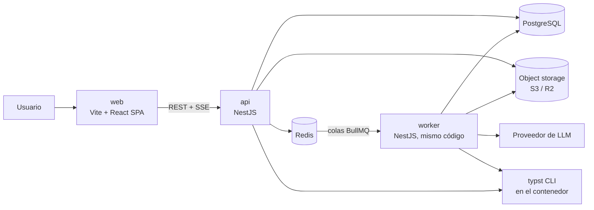
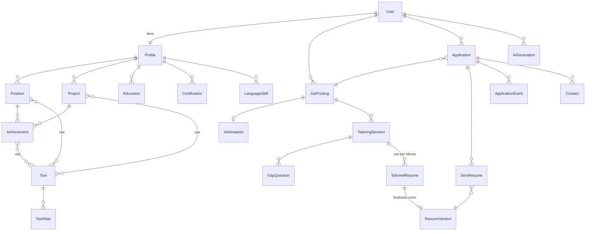
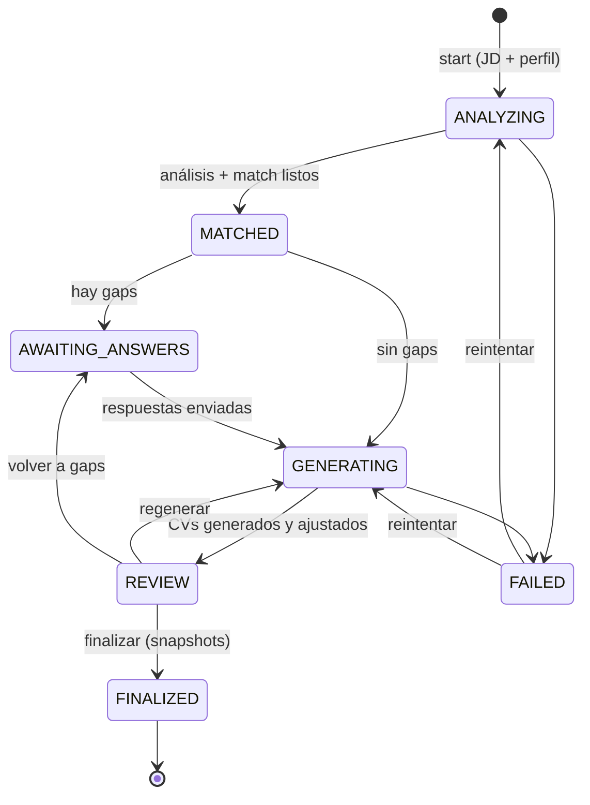

# Careerly — Arquitectura

> Estado: borrador v0.1 · Última actualización: 2026-11-10
> Documentos relacionados: [REQUIREMENTS.md](REQUIREMENTS.md) · [ROADMAP.md](ROADMAP.md)

## 1. Drivers de la arquitectura

Lo que más influye en las decisiones, en orden:

1. **El flujo de adaptación tiene lógica de dominio real:** match, gaps, reglas de veracidad, ajuste a páginas
   y una máquina de estados de sesión. Tiene que poder testearse sin IA, sin base de datos y sin Typst.
2. **La IA es lenta, cara, falible y reemplazable.** Debe estar aislada detrás de una interfaz, poder
   ejecutarse en segundo plano y poder reemplazarse por un *fake* en tests.
3. **Inmutabilidad de lo enviado:** los snapshots se tienen que poder reproducir exactamente.
4. **Equipo chico (1 persona).** La arquitectura no puede exigir más operación de la necesaria.
5. **Datos personales sensibles:** aislamiento por usuario y cuidado con logs y proveedores externos.

## 2. Decisión principal

**Monolito modular** en NestJS, con **arquitectura hexagonal (puertos y adaptadores) solo en los módulos con
lógica de dominio**, y un **proceso worker** (mismo código, otro punto de entrada) para las tareas largas.

| Alternativa | Por qué no (o no todavía) |
|---|---|
| Monolito en capas tradicional | La lógica de adaptación y la de IA terminarían acopladas a Nest, Prisma y el SDK del proveedor. Difícil de testear. |
| Hexagonal en todos los módulos | Burocracia innecesaria para módulos CRUD (contactos, datos personales). |
| Microservicios | Costos de red, despliegue, observabilidad y consistencia distribuida sin beneficio a esta escala. |
| Serverless puro | El render con Typst y las tareas de IA de hasta 60 s encajan mejor en un contenedor y una cola. |

**Camino de evolución:** los módulos se comunican solo a través de su API pública (servicios de aplicación y
eventos). Si algún día un módulo necesita escalar por separado (p. ej. el render), se puede extraer sin
reescribir el dominio.

## 3. Vista de contenedores



| Contenedor | Responsabilidad |
|---|---|
| `web` | SPA. Formularios del perfil, flujo de adaptación, vista previa del PDF y kanban de postulaciones. |
| `api` | HTTP REST, autenticación, validación, casos de uso síncronos y encolado de tareas largas. Publica progreso por SSE. |
| `worker` | Consume colas: análisis de JD, match, generación de CVs y render. |
| PostgreSQL | Datos de dominio. JSONB para contenido flexible (análisis de JD, datos de CV adaptado). |
| Redis | Colas (BullMQ), pub/sub de progreso para SSE y rate limiting. |
| Object storage | PDFs de snapshots. Bucket privado; descarga mediante URLs firmadas de vida corta. |
| typst CLI | Binario dentro de la imagen Docker. El render rápido de vista previa puede ejecutarse en `api`; el resto, en `worker`. |

## 4. Módulos (bounded contexts)

```
identity ──────────────── (todos dependen de identity para el userId)
profile      ◄── tailoring ──► job-postings
                    │
                    ├──► documents (render Typst, snapshots)
                    └──► ai (adaptadores de LLM)
applications ──► job-postings, documents (snapshots)
dashboard    ──► applications (solo lectura)
```

| Módulo | Estilo | Responsabilidad |
|---|---|---|
| `identity` | Capas | Usuarios, autenticación, sesiones, borrado de cuenta. |
| `profile` | Capas + dominio ligero | Perfil maestro: experiencias, logros, proyectos, educación, certificaciones, idiomas, catálogo de herramientas. Registra el origen de cada elemento y permite revertir cambios por sesión. |
| `job-postings` | Capas | JDs y su análisis estructurado. |
| `tailoring` | **Hexagonal** | Sesión de adaptación: match, gaps, generación, ajuste a páginas, revisión y finalización. |
| `documents` | **Hexagonal** | Plantillas, render con Typst, conteo de páginas, snapshots inmutables y almacenamiento de PDFs. |
| `applications` | **Hexagonal** | Postulaciones, máquina de estados, línea de tiempo, contactos, entrevistas. |
| `ai` | Infraestructura | Adaptadores de LLM, prompts versionados, salida estructurada, registro de uso y costo, cuotas. |
| `dashboard` | Lectura | Consultas agregadas (sin dominio propio). |

**Reglas de dependencia (verificadas con ESLint, p. ej. `eslint-plugin-boundaries`):**

- Un módulo no accede a las tablas ni a los repositorios de otro módulo; usa su servicio de aplicación público.
- `domain/` no importa nada de NestJS, Prisma, el SDK del LLM ni Node APIs de E/S.
- `application/` depende solo de `domain/` y de los puertos que define.
- Solo `infrastructure/` y `http/` conocen frameworks y librerías externas.

## 5. Anatomía de un módulo hexagonal

```
apps/api/src/modules/tailoring/
  domain/
    tailoring-session.ts        # agregado + máquina de estados
    match.ts                    # Requirement, MatchResult (cubierto/parcial/faltante)
    gap.ts                      # GapQuestion, GapAnswer
    page-fitter.ts              # algoritmo de ajuste (puro)
    veracity-guard.ts           # RN-01, RN-02 (puro)
    ports/
      requirement-matcher.port.ts
      resume-writer.port.ts     # "redactá estos bullets" → salida estructurada
      resume-renderer.port.ts   # datos → PDF + cantidad de páginas
      profile-reader.port.ts    # lectura del perfil maestro
      profile-writer.port.ts    # alta de afirmaciones desde gaps
      session-repository.port.ts
  application/
    start-session.use-case.ts
    answer-gaps.use-case.ts
    generate-resumes.use-case.ts
    edit-resume.use-case.ts
    finalize-session.use-case.ts
    revert-profile-changes.use-case.ts
  infrastructure/
    prisma-session.repository.ts
    llm-resume-writer.adapter.ts
    llm-requirement-matcher.adapter.ts
    profile-module.adapter.ts   # implementa ProfileReader/Writer usando el módulo profile
    documents-module.adapter.ts # implementa ResumeRenderer usando el módulo documents
  http/
    tailoring.controller.ts
    dto/
  tailoring.module.ts           # wiring de puertos → adaptadores (DI de Nest)
```

En los tests, cada puerto tiene un adaptador *fake* en memoria. Los casos de uso se testean completos
sin red, sin base de datos y sin Typst.

## 6. Modelo de datos (resumen)



### Entidades clave

| Entidad | Campos importantes | Notas |
|---|---|---|
| `Position` | company, title, startDate, endDate?, location, workMode, context | Experiencia laboral. |
| `Project` | name, kind (`PERSONAL`, `OPEN_SOURCE`, `COURSE`, `FREELANCE`), url?, dates, description | Misma forma que `Position` a efectos de logros. |
| `Achievement` | text, metrics?, toolIds[], origin, originSessionId? | Unidad mínima. Puede ser muy detallado: es material de base, no texto final. |
| `Tool` | canonicalName, category | Catálogo global (compartido entre usuarios). |
| `ToolAlias` | alias → toolId | Resuelve sinónimos ("Postgres" → PostgreSQL). |
| `JobAnalysis` | requirements (JSONB), language, seniority, promptVersion | Salida validada de la IA, editable por el usuario. |
| `TailoringSession` | status, jobPostingId, languages[], pageBudget, templateId, matchResult (JSONB) | Agregado principal del módulo `tailoring`. |
| `GapQuestion` | requirement, kind (`MISSING`, `PARTIAL`), relatedEvidence, answer (`USED_AT_WORK`, `USED_ELSEWHERE`, `NOT_USED`, `SKIPPED`), answerDetail, includeInResume, createdEntityIds[] | El "No" vive **solo acá**, nunca en el perfil (RN-11, RN-12). |
| `TailoredResume` | sessionId, language, data (JSONB), pageCount, fitLog | Editable hasta finalizar. Cada bullet guarda `sourceIds[]`, `score` y `editedByUser`. |
| `ResumeVersion` | data (JSONB), language, templateId, templateVersion, pdfKey, pageCount, contentHash, createdAt | **Inmutable.** Sin `UPDATE` en el repositorio. |
| `Application` | jobPostingId, status, channel, priority, salaryExpected?, salaryOffered?, appliedAt? | |
| `SentResume` | applicationId, resumeVersionId, sentAt | Permite varios CVs enviados (p. ej. ES y EN). |
| `ApplicationEvent` | type (`STATUS_CHANGE`, `NOTE`, `INTERVIEW`, `MESSAGE`), payload (JSONB), occurredAt | Línea de tiempo, *append-only*. |
| `AiGeneration` | userId, task, model, promptVersion, inputTokens, outputTokens, costUsd, latencyMs, status | Sin contenido del prompt en producción (RNF-02). |

**Origen y reversión en el perfil (RF-PROF-07, RF-TAIL-06):** todo elemento creado desde un gap guarda
`origin = GAP_ANSWER` y `originSessionId`. "Deshacer" borra esos elementos (o restaura el texto anterior, si
se modificó uno existente, para lo cual se guarda un registro de cambios mínimo por sesión).

## 7. Pipeline de adaptación

### 7.1 Máquina de estados de la sesión



### 7.2 Pasos

| # | Paso | Dónde | Tipo |
|---|---|---|---|
| 1 | **Análisis de JD:** extraer requisitos estructurados. | worker | LLM (modelo chico/rápido) + validación Zod |
| 2 | **Normalización:** mapear herramientas de la JD al catálogo (alias, minúsculas, variantes). | api/worker | Determinístico |
| 3 | **Match determinístico:** requisitos de herramientas vs. herramientas del perfil. | dominio | Determinístico |
| 4 | **Match semántico:** requisitos no-herramienta ("liderar equipos") vs. logros. Devuelve evidencia por id. | worker | LLM + validación de que los ids existen |
| 5 | **Gaps:** generar preguntas para lo faltante o parcial. | dominio | Determinístico (el texto de la pregunta sale de plantillas, no del LLM) |
| 6 | **Respuestas:** aplicar respuestas afirmativas al perfil (vía puerto `ProfileWriter`). | dominio + profile | Determinístico |
| 7 | **Puntuación:** relevancia de cada logro/proyecto frente a la JD (0–1). | worker | LLM (o embeddings + reranking más adelante) |
| 8 | **Redacción:** bullets y resumen en el idioma pedido, con `sourceIds`. | worker | LLM (modelo grande) + salida estructurada |
| 9 | **Guardia de veracidad:** RN-01, RN-02, RN-03. Bullets inválidos se descartan o se regeneran (máx. 1 reintento). | dominio | Determinístico |
| 10 | **Ajuste de páginas** (ver §8). | dominio + documents | Determinístico + Typst |
| 11 | **Revisión y finalización:** snapshot por idioma. | api | Determinístico |

**Por qué dividirlo en pasos y no hacer "un gran prompt":** cada paso es testeable, se puede reintentar por
separado, permite modelos distintos según la tarea (costo) y deja puntos donde validar en código lo que
devolvió la IA.

### 7.3 IA: proveedor, prompts y salidas

- **Puerto `LlmClient`** en el módulo `ai` con operaciones tipadas: `extractRequirements`, `matchEvidence`,
  `scoreRelevance`, `writeResume`. Cada una recibe y devuelve tipos de dominio; el adaptador arma el prompt.
- **Proveedor por defecto:** Claude (Anthropic). Modelo grande para la redacción (paso 8) y modelo chico para
  extracción y puntuación (pasos 1, 4, 7). Los modelos se configuran por variable de entorno, no en código.
- **Salida estructurada:** uso de *tool use* / JSON schema del proveedor + validación con Zod. Si no valida, un
  reintento con el error; si vuelve a fallar, el paso queda en `FAILED`.
- **Prompts versionados** como archivos en el repo (`ai/prompts/*.v3.md`). `promptVersion` se guarda en
  `AiGeneration` y en `JobAnalysis`.
- **Prompt injection:** el texto de la JD va delimitado y declarado como dato no confiable; la IA nunca recibe
  herramientas con efectos (solo devuelve JSON); la guardia de veracidad impide que una JD "inyecte"
  experiencia en el CV.
- **Prompt caching:** el perfil maestro es el bloque grande y estable de cada sesión; se ubica primero en el
  prompt para aprovechar el caché del proveedor.
- **Cuotas:** antes de encolar una tarea de IA, `ai` verifica la cuota diaria del usuario (Redis).

## 8. Ajuste a 1–2 páginas

El LLM no puede medir páginas, así que el ajuste es **determinístico** y usa Typst como "regla":

```
entrada: candidatos (bullets con score), presupuesto de páginas, reglas de sección
1. Armar el CV con reglas iniciales:
     - puesto actual/más reciente: hasta 5 bullets
     - puestos de los últimos ~10 años: hasta 3 bullets
     - puestos más antiguos: solo empresa, rol y fechas
     - proyectos: solo si el usuario los marcó como relevantes o cubren un requisito
2. Renderizar con Typst → contar páginas
3. Mientras páginas > presupuesto:
     quitar el bullet de menor score (respetando un mínimo de 1 bullet por puesto reciente)
     re-renderizar
4. Si sobra mucho espacio (< 85 % de la última página) y hay candidatos descartados:
     agregar el de mayor score y verificar que siga entrando
5. Guardar fitLog (qué se quitó y por qué) → visible para el usuario en la revisión
```

- Typst compila un CV en milisegundos, por lo que 10–20 iteraciones son aceptables.
- **Conteo de páginas:** la plantilla expone la cantidad de páginas como metadata
  (`#context metadata(counter(page).final())<page-count>`) y se lee con `typst query`, o se cuenta en el PDF
  resultante. Se elegirá una de las dos en la Fase 3 del roadmap.
- `page-fitter.ts` es puro: recibe una función `measure(resume) → pageCount` (el puerto), así que se testea
  con un medidor falso.

## 9. Render con Typst (módulo `documents`)

```
apps/api/templates/
  classic/
    template.typ          # lee los datos con json(sys.inputs.data) o un archivo data.json
    i18n.json             # títulos de sección por idioma
    fonts/                # fuentes embebidas (licencia libre)
    template.json         # id, versión, idiomas soportados
```

- **Datos, no código:** el adaptador escribe `data.json` en un directorio temporal y la plantilla lo lee.
  El contenido del usuario nunca se concatena dentro de un `.typ` (RNF-05).
- **Ejecución aislada:** `typst compile` con `--root` limitado al directorio temporal, `--font-path` a las
  fuentes empaquetadas, timeout (p. ej. 10 s) y sin acceso a red. Directorio temporal eliminado al terminar.
- **Versionado de plantillas:** cada cambio de plantilla incrementa `templateVersion`. Los snapshots guardan la
  versión; las versiones viejas se conservan para poder volver a renderizar (RNF-10).
- **Plantillas compatibles con ATS:** una columna, títulos estándar traducidos por idioma, sin tablas para el
  diseño, sin texto en imágenes y fuentes embebidas.
- **Vista previa:** endpoint que renderiza el `TailoredResume` actual y devuelve el PDF (o PNG por página).
  A futuro, vista previa en el navegador con `typst.ts` (WASM).
- **Snapshots:** al finalizar se renderiza, se calcula `contentHash` (datos + plantilla + versión), se sube el PDF
  al bucket y se guarda `ResumeVersion` en una transacción.

## 10. Procesamiento asíncrono y progreso

- **Colas BullMQ:** `jd-analysis`, `tailoring` (pasos 4–10) y `render-snapshot`. Reintentos con backoff
  exponencial; *jobs* idempotentes por `sessionId + step`.
- **Progreso:** el worker publica eventos (`step-started`, `step-done`, `failed`) en Redis pub/sub; la API los
  reenvía al cliente por **SSE** (`GET /tailoring-sessions/:id/events`). El cliente también puede consultar el
  estado por polling si se pierde la conexión.
- **Estado persistido:** el estado de la sesión vive en PostgreSQL, no en la cola. Si el worker se reinicia, la
  sesión puede retomarse.

## 11. API (resumen)

REST, JSON y validación con esquemas Zod compartidos (`packages/contracts`).

```
POST   /auth/register | /auth/login | /auth/logout | /auth/forgot-password
DELETE /me                                         # borrar cuenta y datos

GET    /profile
PATCH  /profile/personal-info
CRUD   /profile/positions, /profile/positions/:id/achievements
CRUD   /profile/projects, /profile/education, /profile/certifications, /profile/languages
GET    /tools?query=                               # catálogo con alias

CRUD   /job-postings
POST   /job-postings/:id/analyze
PATCH  /job-postings/:id/analysis                  # correcciones del usuario

POST   /tailoring-sessions                         # { jobPostingId, languages[], pageBudget, templateId }
GET    /tailoring-sessions/:id
GET    /tailoring-sessions/:id/events              # SSE
GET    /tailoring-sessions/:id/gaps
PUT    /tailoring-sessions/:id/gaps                # respuestas
POST   /tailoring-sessions/:id/generate
PATCH  /tailoring-sessions/:id/resumes/:lang       # ediciones
GET    /tailoring-sessions/:id/resumes/:lang/preview
POST   /tailoring-sessions/:id/finalize
POST   /tailoring-sessions/:id/revert-profile-changes

GET    /resume-versions/:id
GET    /resume-versions/:id/pdf                    # redirect a URL firmada

CRUD   /applications
POST   /applications/:id/status                    # transición validada por el dominio
POST   /applications/:id/sent-resumes
CRUD   /applications/:id/events, /applications/:id/contacts

GET    /dashboard/summary
```

## 12. Frontend

- **Vite + React + TypeScript.**
- **Routing:** React Router (o TanStack Router).
- **Datos de servidor:** TanStack Query. Sin store global salvo para estado de UI puntual.
- **Formularios:** React Hook Form + resolvers de Zod usando `packages/contracts`.
- **UI:** librería de componentes accesibles (p. ej. shadcn/ui sobre Radix + Tailwind). Kanban con `dnd-kit`.
- **i18n de la interfaz:** `react-i18next` (ES y EN).
- **Organización por *feature*:**

```
apps/web/src/
  features/
    auth/  profile/  job-postings/  tailoring/  applications/  dashboard/
      api/          # hooks de TanStack Query
      components/
      pages/
  shared/           # UI base, layout, utilidades
```

- **Flujo de adaptación como *wizard*:** JD → análisis → gaps → opciones (idiomas, páginas, plantilla) →
  generación con progreso → revisión con vista previa en paralelo → finalizar → crear o vincular postulación.

## 13. Monorepo y herramientas

```
careerly/
  apps/
    web/                 # Vite + React
    api/                 # NestJS (main.ts = HTTP, worker.ts = colas)
  packages/
    contracts/           # esquemas Zod + tipos compartidos (DTOs, enums de estado)
    eslint-config/
    tsconfig/
  docker-compose.yml     # postgres, redis, minio (S3 local)
  REQUIREMENTS.md  ARCHITECTURE.md  ROADMAP.md
```

- **pnpm workspaces** (+ Turborepo si los tiempos de build lo justifican).
- **ORM:** Prisma (migraciones maduras y buen DX) o Drizzle (más cercano a SQL). Decisión en la Fase 0.
- **Calidad:** ESLint + Prettier, `tsc --noEmit` y tests en CI (GitHub Actions) en cada PR.

## 14. Seguridad y privacidad

- **Autenticación:** sesiones con cookie `httpOnly`, `Secure` y `SameSite=Lax`, almacenadas en Redis.
  Contraseñas con argon2id. Rate limiting en login y en endpoints de IA.
- **Aislamiento por usuario:** todo repositorio exige `userId`; tests de integración que verifican que un usuario
  no accede a datos de otro. Evaluar *Row Level Security* de PostgreSQL como segunda barrera.
- **Archivos:** bucket privado; PDFs solo vía URLs firmadas de pocos minutos.
- **Logs:** sin contenido del perfil, JDs ni prompts; solo ids, tamaños, tiempos y errores.
- **Proveedor de IA:** usar las opciones del proveedor que no retienen ni entrenan con los datos, y
  documentarlo en la política de privacidad.
- **Borrado de cuenta:** borrado en cascada en PostgreSQL + borrado de objetos en el bucket + registros de
  `AiGeneration` anonimizados.

## 15. Estrategia de testing

| Nivel | Qué se prueba | Herramientas |
|---|---|---|
| Dominio | Máquinas de estado, match, gaps, guardia de veracidad, `page-fitter` | Vitest/Jest, sin I/O |
| Casos de uso | Flujos completos con adaptadores *fake* (LLM, renderer, repos) | Vitest/Jest |
| Integración | Repositorios Prisma, render Typst real, colas | Testcontainers (Postgres, Redis) |
| Evaluación de IA | Conjunto fijo de perfiles + JDs: requisitos extraídos, cero bullets inventados, CVs dentro del límite de páginas | Script de evals propio, corrido manualmente al cambiar prompts o modelos |
| E2E | Flujo completo: perfil → JD → gaps → CV → postulación | Playwright, con el LLM *fake* |

## 16. Despliegue y operación

- **Imágenes Docker:** una para `api` y `worker` (incluye el binario de `typst` y las fuentes) y una estática
  para `web`.
- **Hosting sugerido:** `web` en Vercel o Cloudflare Pages; `api` + `worker` en Railway, Fly.io o Render;
  PostgreSQL y Redis gestionados; Cloudflare R2 o S3 para PDFs.
- **Configuración:** variables de entorno validadas al iniciar (Zod). Secretos fuera del repo.
- **Observabilidad:** logs estructurados (pino), errores (Sentry), métricas de colas y del uso/costo de IA
  (a partir de `AiGeneration`).

## 17. Registro de decisiones

| # | Decisión | Estado |
|---|---|---|
| ADR-01 | Monolito modular + hexagonal selectiva + worker | Aceptada |
| ADR-02 | NestJS sobre Express como servidor HTTP | Aceptada |
| ADR-03 | Typst para el render de CVs, con datos en JSON | Aceptada |
| ADR-04 | Perfil maestro solo con afirmaciones; negaciones únicamente en el historial de sesión | Aceptada |
| ADR-05 | Ajuste de páginas determinístico (render + recorte por score), no delegado al LLM | Aceptada |
| ADR-06 | Prisma vs. Drizzle | Pendiente (Fase 0) |
| ADR-07 | Conteo de páginas: `typst query` vs. lectura del PDF | Pendiente (Fase 3) |
| ADR-08 | Puntuación de relevancia: LLM vs. embeddings (`pgvector`) | Pendiente (post-MVP) |
