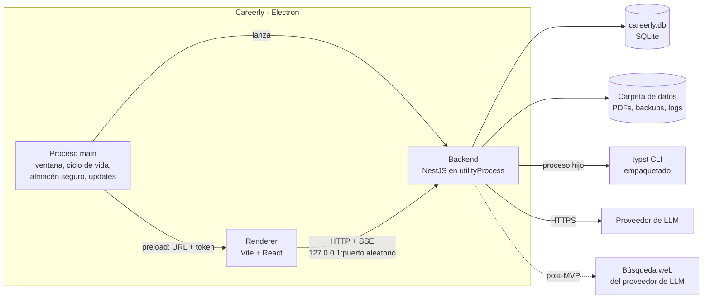
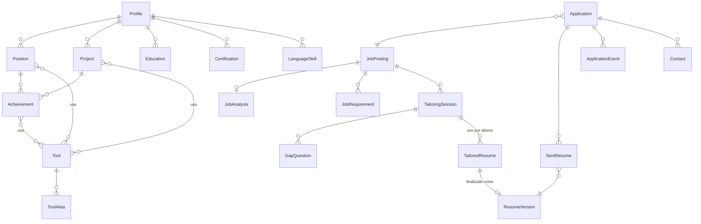
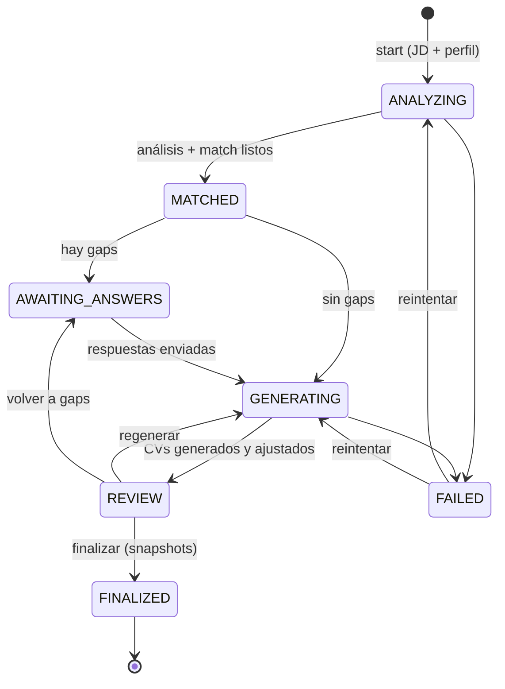

# Careerly — Arquitectura

> Estado: borrador v0.2 · Última actualización: 2026-11-10
> Documentos relacionados: [REQUIREMENTS.md](REQUIREMENTS.md) · [ROADMAP.md](ROADMAP.md)

## 1. Drivers de la arquitectura

Lo que más influye en las decisiones, en orden:

1. **App de escritorio personal, de un solo usuario y con datos locales.** Sin cuentas, sin servidor en la
   nube y sin infraestructura que operar.
2. **El flujo de adaptación tiene lógica de dominio real:** match, gaps, reglas de veracidad, ajuste a páginas
   y una máquina de estados de sesión. Tiene que poder testearse sin IA, sin base de datos y sin Typst.
3. **La IA es lenta, cara, falible y reemplazable.** Debe estar aislada detrás de una interfaz, ejecutarse en
   segundo plano y poder reemplazarse por un *fake* en tests.
4. **Inmutabilidad de lo enviado:** los snapshots se tienen que poder reproducir exactamente.
5. **Distribución simple:** instaladores para Windows (prioridad), macOS y Linux, y ejecución desde el código.

## 2. Decisiones principales

- **Electron** como contenedor de escritorio (ADR-12).
- **Monolito modular en NestJS** que corre localmente dentro de la app, con **arquitectura hexagonal solo en
  los módulos con lógica de dominio** (ADR-01).
- **SQLite** como base de datos, en un archivo dentro de la carpeta de datos del usuario (ADR-06).
- **Tareas largas en segundo plano dentro del mismo proceso**, con una cola persistida en SQLite: no hace
  falta Redis ni un worker aparte (ADR-15).
- **La interfaz habla con el backend por HTTP local** (`127.0.0.1`, puerto aleatorio, token por sesión), igual
  que una app cliente-servidor (ADR-13).

### ¿Por qué Electron y no Tauri?

| | Electron | Tauri |
|---|---|---|
| Backend | Node.js: **NestJS corre tal cual** | Rust. NestJS solo como *sidecar* (empaquetar Node aparte) |
| Tamaño del instalador | ~100 MB | ~10 MB |
| Madurez para auto-update, empaquetado y E2E | Muy alta (electron-builder, electron-updater, Playwright) | Buena, pero el sidecar de Node complica todo |

Tauri obligaría a reescribir el backend en Rust o a empaquetar Node como sidecar. Para un proyecto personal con
React + NestJS, el tamaño extra de Electron es un costo aceptable.

### ¿Por qué SQLite?

- Un solo usuario y un solo proceso escribiendo: el caso ideal de SQLite.
- Es un archivo: los backups son copiar un archivo (RF-CONF-04) y no hay servidor que instalar.
- Cubre lo que se usaba de PostgreSQL: columnas JSON (funciones JSON1), búsqueda de texto completo (FTS5) y, si
  hiciera falta, vectores para embeddings (`sqlite-vec`, ADR-08).

### Alternativas descartadas

| Alternativa | Por qué no |
|---|---|
| Mantener la versión web multiusuario | No es el objetivo (proyecto personal, D-01); agrega auth, hosting y costos. |
| Monolito en capas tradicional | La lógica de adaptación y la de IA quedarían acopladas a Nest, al ORM y al SDK del proveedor. |
| Hexagonal en todos los módulos | Burocracia innecesaria para módulos CRUD (contactos, datos personales). |
| IPC de Electron en lugar de HTTP local | Obliga a reemplazar los controllers de Nest y el streaming por SSE; HTTP permite además desarrollar la interfaz en el navegador. |

## 3. Procesos de la aplicación



| Proceso | Responsabilidad |
|---|---|
| **main** (Electron) | Crea la ventana, garantiza una sola instancia, lanza el backend con `utilityProcess.fork`, guarda la API key con `safeStorage`, gestiona actualizaciones (electron-updater) y abre enlaces externos en el navegador del sistema. |
| **preload** | Expone al renderer, vía `contextBridge`, solo lo mínimo: URL del backend, token de sesión y unas pocas acciones nativas (abrir la carpeta de datos, elegir archivo de backup). |
| **renderer** | La SPA de React. Sin acceso a Node (`contextIsolation`, `sandbox`, sin `nodeIntegration`). |
| **backend** (NestJS) | API HTTP, casos de uso, acceso a SQLite, cola de tareas en segundo plano, llamadas a la IA y render con Typst. |

### Arranque

```
1. main obtiene la carpeta de datos (app.getPath('userData')) y genera un token aleatorio
2. main lanza el backend con: carpeta de datos, token y API key (descifrada con safeStorage, solo en memoria)
3. backend: backup automático si hay migraciones pendientes → aplica migraciones → reanuda tareas pendientes
   → escucha en 127.0.0.1:0 (puerto libre) → informa el puerto a main
4. main abre la ventana; el preload entrega URL + token al renderer
```

Si el usuario cambia la API key, main la vuelve a cifrar y se la envía al backend por mensaje, sin reiniciar.

### Modos de ejecución (RNF-18)

| Modo | Comando | Uso |
|---|---|---|
| Release instalada | Instalador desde GitHub Releases | Uso normal, con actualizaciones automáticas. |
| Desde el código | `npm install` + `npm start` | Compila todo y abre Electron, que lanza la API en un `utilityProcess`. Sin instalador ni auto-update. |
| Desarrollo | `npm run dev` | Vite con HMR + API en modo watch (proceso de Node aparte, puerto 4317) + Electron cargando la URL de Vite y conectándose a esa API. |
| Desarrollo solo en el navegador | `npm run dev:web` | API en modo watch + interfaz en el navegador (`localhost:5173`). Útil para depurar. |

En los modos de desarrollo la API usa un token fijo, no secreto, definido en los archivos
`.env.development`, y guarda los datos en `.data/` (ignorado por git).

### Carpeta de datos

```
<userData>/Careerly/
  careerly.db            # SQLite (modo WAL)
  files/
    snapshots/<id>.pdf   # PDFs de CVs finalizados (inmutables)
    guides/<id>.pdf      # guías de entrevista exportadas (post-MVP)
  backups/               # backups automáticos previos a migraciones + backups manuales
  logs/                  # logs rotativos, sin contenido sensible
  secrets.bin            # API key cifrada con safeStorage (la escribe y lee solo main)
```

## 4. Módulos (bounded contexts)

```
settings ─────────────── (configuración, consumo de IA, backups)
profile      ◄── tailoring ──► job-postings
                    │
                    ├──► documents (render Typst, snapshots)
                    └──► ai (adaptadores de LLM)
applications ──► job-postings, documents (snapshots)
dashboard    ──► applications (solo lectura)

post-MVP:
insights       ──► job-postings, profile, tailoring (solo lectura) ──► ai
interview-prep ──► applications, job-postings, documents, profile (solo lectura) ──► ai
```

| Módulo | Estilo | Responsabilidad |
|---|---|---|
| `settings` | Capas | Preferencias no secretas, consumo y presupuesto de IA, backup/restauración, borrado de datos. |
| `profile` | Capas + dominio ligero | Perfil maestro: experiencias, logros, proyectos, educación, certificaciones, idiomas, catálogo de herramientas. Registra el origen de cada elemento y permite revertir cambios por sesión. |
| `job-postings` | Capas | JDs y su análisis estructurado. |
| `tailoring` | **Hexagonal** | Sesión de adaptación: match, gaps, generación, ajuste a páginas, revisión y finalización. |
| `documents` | **Hexagonal** | Plantillas, render con Typst, conteo de páginas, snapshots inmutables y archivos PDF. |
| `applications` | **Hexagonal** | Postulaciones, máquina de estados, línea de tiempo, contactos, entrevistas. |
| `ai` | Infraestructura | Adaptadores de LLM, prompts versionados, salida estructurada, registro de uso y costo. |
| `jobs` | Infraestructura | Cola de tareas persistida en SQLite y su ejecutor (ver §10). |
| `dashboard` | Lectura | Consultas agregadas (sin dominio propio). |
| `insights` *(post-MVP)* | Dominio ligero | Gaps recurrentes entre JDs y recomendaciones de capacitación (ver §18.1). |
| `interview-prep` *(post-MVP)* | **Hexagonal** | Research de empresas, guías de entrevista por etapa, debriefs (ver §18.2). |

**Reglas de dependencia (verificadas con ESLint, p. ej. `eslint-plugin-boundaries`):**

- Un módulo no accede a las tablas ni a los repositorios de otro módulo; usa su servicio de aplicación público.
- `domain/` no importa nada de NestJS, Drizzle, el SDK del LLM ni APIs de Node con E/S.
- `application/` depende solo de `domain/` y de los puertos que define.
- Solo `infrastructure/` y `http/` conocen frameworks y librerías externas.
- El backend no importa nada de Electron: recibe todo lo que necesita (carpeta de datos, token, API key) por
  configuración. Así se puede ejecutar y testear fuera de Electron.

## 5. Anatomía de un módulo hexagonal

```
apps/api/src/modules/tailoring/
  domain/
    tailoring-session.ts        # agregado + máquina de estados
    match.ts                    # Requirement, MatchResult (cubierto/parcial/faltante)
    gap.ts                      # GapQuestion, GapAnswer
    page-fitter.ts              # algoritmo de ajuste (puro)
    veracity-guard.ts           # RN-01, RN-02 (puro)
    ports/
      requirement-matcher.port.ts
      resume-writer.port.ts     # "redactá estos bullets" → salida estructurada
      resume-renderer.port.ts   # datos → PDF + cantidad de páginas
      profile-reader.port.ts    # lectura del perfil maestro
      profile-writer.port.ts    # alta de afirmaciones desde gaps
      session-repository.port.ts
  application/
    start-session.use-case.ts
    answer-gaps.use-case.ts
    generate-resumes.use-case.ts
    edit-resume.use-case.ts
    finalize-session.use-case.ts
    revert-profile-changes.use-case.ts
  infrastructure/
    drizzle-session.repository.ts
    llm-resume-writer.adapter.ts
    llm-requirement-matcher.adapter.ts
    profile-module.adapter.ts   # implementa ProfileReader/Writer usando el módulo profile
    documents-module.adapter.ts # implementa ResumeRenderer usando el módulo documents
  http/
    tailoring.controller.ts
    dto/
  tailoring.module.ts           # wiring de puertos → adaptadores (DI de Nest)
```

En los tests, cada puerto tiene un adaptador *fake* en memoria. Los casos de uso se testean completos sin red,
sin base de datos y sin Typst.

## 6. Modelo de datos (resumen)

Al haber un solo usuario, **no hay tabla de usuarios ni columnas `userId`**. El perfil maestro es único.



Tablas de soporte sin relaciones de dominio: `AiGeneration`, `Job` (cola), `Setting`.

### Entidades clave

| Entidad | Campos importantes | Notas |
|---|---|---|
| `Profile` | datos personales, titular, links | Fila única. |
| `Position` | company, title, startDate, endDate?, location, workMode, context | Experiencia laboral. |
| `Project` | name, kind (`PERSONAL`, `OPEN_SOURCE`, `COURSE`, `FREELANCE`), url?, dates, description | Misma forma que `Position` a efectos de logros. |
| `Achievement` | text, metrics?, toolIds[], origin, originSessionId? | Unidad mínima. Puede ser muy detallado: es material de base, no texto final. |
| `Tool` | canonicalName, category, isCustom | Catálogo inicial incluido en la app (*seed*) + herramientas creadas por el usuario. |
| `ToolAlias` | alias → toolId | Resuelve sinónimos ("Postgres" → PostgreSQL). |
| `JobAnalysis` | requirements (JSON), language, seniority, promptVersion | Salida validada de la IA, editable por el usuario. |
| `JobRequirement` | jobPostingId, toolId?, label, kind, importance | Requisitos normalizados para poder agregarlos entre JDs (ADR-09, §18.1). |
| `TailoringSession` | status, jobPostingId, languages[], pageBudget, templateId, matchResult (JSON) | Agregado principal del módulo `tailoring`. |
| `GapQuestion` | requirement, kind (`MISSING`, `PARTIAL`), relatedEvidence, answer (`USED_AT_WORK`, `USED_ELSEWHERE`, `NOT_USED`, `SKIPPED`), answerDetail, includeInResume, createdEntityIds[] | El "No" vive **solo acá**, nunca en el perfil (RN-11, RN-12). |
| `TailoredResume` | sessionId, language, data (JSON), pageCount, fitLog | Editable hasta finalizar. Cada bullet guarda `sourceIds[]`, `score` y `editedByUser`. |
| `ResumeVersion` | data (JSON), language, templateId, templateVersion, pdfPath, pageCount, contentHash, createdAt | **Inmutable.** Sin `UPDATE` en el repositorio. |
| `Application` | jobPostingId, status, channel, priority, salaryExpected?, salaryOffered?, appliedAt? | |
| `SentResume` | applicationId, resumeVersionId, sentAt | Permite varios CVs enviados (p. ej. ES y EN). |
| `ApplicationEvent` | type (`STATUS_CHANGE`, `NOTE`, `INTERVIEW`, `MESSAGE`), payload (JSON), occurredAt | Línea de tiempo, *append-only*. |
| `AiGeneration` | task, model, promptVersion, inputTokens, outputTokens, costUsd, latencyMs, status | Base del consumo y presupuesto (RF-CONF-06, RF-CONF-07). |
| `Setting` | key, value (JSON) | Preferencias no secretas. La API key **no** se guarda acá. |

**Origen y reversión en el perfil (RF-PROF-07, RF-TAIL-06):** todo elemento creado desde un gap guarda
`origin = GAP_ANSWER` y `originSessionId`. "Deshacer" borra esos elementos (o restaura el texto anterior, si se
modificó uno existente, para lo cual se guarda un registro de cambios mínimo por sesión).

**Columnas JSON:** en SQLite se guardan como `TEXT`, se validan con Zod al leer y escribir, y se consultan con
las funciones JSON1 cuando hace falta.

## 7. Pipeline de adaptación

### 7.1 Máquina de estados de la sesión



### 7.2 Pasos

| # | Paso | Tipo |
|---|---|---|
| 1 | **Análisis de JD:** extraer requisitos estructurados. | LLM (modelo chico/rápido) + validación Zod |
| 2 | **Normalización:** mapear herramientas de la JD al catálogo (alias, minúsculas, variantes). | Determinístico |
| 3 | **Match determinístico:** requisitos de herramientas vs. herramientas del perfil. | Determinístico |
| 4 | **Match semántico:** requisitos no-herramienta ("liderar equipos") vs. logros. Devuelve evidencia por id. | LLM + validación de que los ids existen |
| 5 | **Gaps:** generar preguntas para lo faltante o parcial. | Determinístico (plantillas de preguntas, no LLM) |
| 6 | **Respuestas:** aplicar respuestas afirmativas al perfil (vía puerto `ProfileWriter`). | Determinístico |
| 7 | **Puntuación:** relevancia de cada logro/proyecto frente a la JD (0–1). | LLM (o embeddings, ADR-08) |
| 8 | **Redacción:** bullets y resumen en el idioma pedido, con `sourceIds`. | LLM (modelo grande) + salida estructurada |
| 9 | **Guardia de veracidad:** RN-01, RN-02, RN-03. Bullets inválidos se descartan o se regeneran (máx. 1 reintento). | Determinístico |
| 10 | **Ajuste de páginas** (ver §8). | Determinístico + Typst |
| 11 | **Revisión y finalización:** snapshot por idioma. | Determinístico |

Los pasos con LLM se ejecutan como tareas en segundo plano (§10).

**Por qué dividirlo en pasos y no hacer "un gran prompt":** cada paso es testeable, se puede reintentar por
separado, permite modelos distintos según la tarea (costo) y deja puntos donde validar en código lo que
devolvió la IA.

### 7.3 IA: proveedor, prompts y salidas

- **Puerto `LlmClient`** en el módulo `ai` con operaciones tipadas: `extractRequirements`, `matchEvidence`,
  `scoreRelevance`, `writeResume`. Cada una recibe y devuelve tipos de dominio; el adaptador arma el prompt.
- **Proveedor por defecto:** Claude (Anthropic), con la **API key del usuario**. Modelo grande para la redacción
  (paso 8) y modelo chico para extracción y puntuación (pasos 1, 4, 7). Los modelos son configurables
  (RF-CONF-09) con valores por defecto en código.
- **Salida estructurada:** *tool use* / JSON schema del proveedor + validación con Zod. Si no valida, un
  reintento con el error; si vuelve a fallar, el paso queda en `FAILED`.
- **Prompts versionados** como archivos en el repo (`ai/prompts/*.v3.md`). `promptVersion` se guarda en
  `AiGeneration` y en `JobAnalysis`.
- **Prompt injection:** el texto de la JD va delimitado y declarado como dato no confiable; la IA nunca recibe
  herramientas con efectos (solo devuelve JSON); la guardia de veracidad impide que una JD "inyecte"
  experiencia en el CV.
- **Prompt caching:** el perfil maestro es el bloque grande y estable de cada sesión; se ubica primero en el
  prompt para aprovechar el caché del proveedor.
- **Costos:** cada llamada registra tokens y costo en `AiGeneration`. Si el usuario configuró un presupuesto
  mensual (RF-CONF-07), se verifica antes de encolar la tarea.
- **Sin conexión:** si no hay red o la API key no es válida, las acciones de IA se deshabilitan con un mensaje
  claro y el resto de la app sigue funcionando (RNF-13).

## 8. Ajuste a 1–2 páginas

El LLM no puede medir páginas, así que el ajuste es **determinístico** y usa Typst como "regla":

```
entrada: candidatos (bullets con score), presupuesto de páginas, reglas de sección
1. Armar el CV con reglas iniciales:
     - puesto actual/más reciente: hasta 5 bullets
     - puestos de los últimos ~10 años: hasta 3 bullets
     - puestos más antiguos: solo empresa, rol y fechas
     - proyectos: solo si el usuario los marcó como relevantes o cubren un requisito
2. Renderizar con Typst → contar páginas
3. Mientras páginas > presupuesto:
     quitar el bullet de menor score (respetando un mínimo de 1 bullet por puesto reciente)
     re-renderizar
4. Si sobra mucho espacio (< 85 % de la última página) y hay candidatos descartados:
     agregar el de mayor score y verificar que siga entrando
5. Guardar fitLog (qué se quitó y por qué) → visible para el usuario en la revisión
```

- Typst compila un CV en milisegundos, por lo que 10–20 iteraciones son aceptables.
- **Conteo de páginas:** la plantilla expone la cantidad de páginas como metadata
  (`#context metadata(counter(page).final())<page-count>`) y se lee con `typst query`, o se cuenta en el PDF
  resultante. Se elegirá una de las dos en la Fase 3 del roadmap (ADR-07).
- `page-fitter.ts` es puro: recibe una función `measure(resume) → pageCount` (el puerto), así que se testea
  con un medidor falso.

## 9. Render con Typst (módulo `documents`)

```
apps/api/templates/
  classic/
    template.typ          # lee los datos con json(sys.inputs.data) o un archivo data.json
    i18n.json             # títulos de sección por idioma
    fonts/                # fuentes embebidas (licencia libre)
    template.json         # id, versión, idiomas soportados
```

- **Binario empaquetado:** el CLI de `typst` se incluye en el instalador por plataforma (`extraResources` de
  electron-builder), con versión fija y checksum verificado al descargarlo en CI. Alternativa a evaluar: el
  compilador de Typst como módulo nativo de Node (ADR-14).
- **Datos, no código:** el adaptador escribe `data.json` en un directorio temporal y la plantilla lo lee. El
  contenido del usuario nunca se concatena dentro de un `.typ` (RNF-05).
- **Ejecución aislada:** `typst compile` como proceso hijo (no bloquea el backend), con `--root` limitado al
  directorio temporal, `--font-path` a las fuentes empaquetadas y timeout (p. ej. 10 s). Directorio temporal
  eliminado al terminar.
- **Versionado de plantillas:** cada cambio de plantilla incrementa `templateVersion`. Los snapshots guardan la
  versión; las versiones viejas se conservan en la app para poder volver a renderizar (RNF-10).
- **Plantillas compatibles con ATS:** una columna, títulos estándar traducidos por idioma, sin tablas para el
  diseño, sin texto en imágenes y fuentes embebidas.
- **Vista previa:** endpoint que renderiza el `TailoredResume` actual y devuelve el PDF; el renderer lo muestra
  con el visor de PDF de Chromium integrado en Electron.
- **Snapshots:** al finalizar se renderiza, se calcula `contentHash` (datos + plantilla + versión), se guarda el
  PDF en `files/snapshots/` y se crea `ResumeVersion` en una transacción. Los archivos de snapshots son de solo
  lectura para la app.

## 10. Tareas en segundo plano (módulo `jobs`)

Sin Redis ni worker aparte: las tareas largas corren en el mismo proceso del backend, que de todos modos pasa
la mayor parte del tiempo esperando respuestas de red (LLM) o procesos hijos (Typst).

- **Cola persistida:** tabla `Job` (id, type, payload, status, attempts, runAt, lastError). Encolar una tarea es
  un `INSERT` en la misma transacción que el cambio de estado de la sesión.
- **Ejecutor:** bucle en el backend con concurrencia limitada (p. ej. 2 tareas a la vez), reintentos con
  *backoff* exponencial y tareas idempotentes por `sessionId + step`.
- **Reanudación:** al iniciar la app, las tareas que quedaron `RUNNING` (porque se cerró la app) vuelven a
  `PENDING` y se reintentan (RNF-13).
- **Progreso:** el ejecutor emite eventos en memoria (`step-started`, `step-done`, `failed`) que el backend
  reenvía a la interfaz por **SSE** (`GET /tailoring-sessions/:id/events`). Si la interfaz se recarga, consulta
  el estado persistido de la sesión.

## 11. API local (resumen)

REST sobre `http://127.0.0.1:<puerto>`, JSON y validación con esquemas Zod compartidos (`packages/contracts`).
Todas las rutas exigen el token de sesión (RNF-19).

```
GET    /settings | PATCH /settings
GET    /settings/ai-usage?from=&to=
POST   /settings/ai-key/verify                     # la key la gestiona main; el backend solo prueba la recibida
POST   /backups | POST /backups/restore | DELETE /data

GET    /profile
PATCH  /profile/personal-info
CRUD   /profile/positions, /profile/positions/:id/achievements
CRUD   /profile/projects, /profile/education, /profile/certifications, /profile/languages
GET    /tools?query=                               # catálogo con alias

CRUD   /job-postings
POST   /job-postings/:id/analyze
PATCH  /job-postings/:id/analysis                  # correcciones del usuario

POST   /tailoring-sessions                         # { jobPostingId, languages[], pageBudget, templateId }
GET    /tailoring-sessions/:id
GET    /tailoring-sessions/:id/events              # SSE
GET    /tailoring-sessions/:id/gaps
PUT    /tailoring-sessions/:id/gaps                # respuestas
POST   /tailoring-sessions/:id/generate
PATCH  /tailoring-sessions/:id/resumes/:lang       # ediciones
GET    /tailoring-sessions/:id/resumes/:lang/preview
POST   /tailoring-sessions/:id/finalize
POST   /tailoring-sessions/:id/revert-profile-changes

GET    /resume-versions/:id
GET    /resume-versions/:id/pdf

CRUD   /applications
POST   /applications/:id/status                    # transición validada por el dominio
POST   /applications/:id/sent-resumes
CRUD   /applications/:id/events, /applications/:id/contacts

GET    /dashboard/summary
```

## 12. Interfaz (renderer)

- **Vite + React + TypeScript.**
- **Routing:** React Router en modo *hash* (compatible con cargar la app desde archivos locales en producción).
- **Datos del backend:** TanStack Query. Sin store global salvo para estado de UI puntual.
- **Formularios:** React Hook Form + resolvers de Zod usando `packages/contracts`.
- **UI:** librería de componentes accesibles (p. ej. shadcn/ui sobre Radix + Tailwind). Kanban con `dnd-kit`.
- **i18n de la interfaz:** `react-i18next` (ES y EN).
- **Puente con Electron:** un único módulo `shared/desktop.ts` lee lo expuesto por el preload; en modo
  `dev:web` usa valores de desarrollo. El resto de la interfaz no sabe si corre en Electron o en el navegador.
- **Organización por *feature*:**

```
apps/web/src/
  features/
    settings/  profile/  job-postings/  tailoring/  applications/  dashboard/
      api/          # hooks de TanStack Query
      components/
      pages/
  shared/           # UI base, layout, cliente HTTP, puente con Electron
```

- **Primer inicio:** asistente para configurar la API key (RF-CONF-01) y el idioma de la interfaz.
- **Flujo de adaptación como *wizard*:** JD → análisis → gaps → opciones (idiomas, páginas, plantilla) →
  generación con progreso → revisión con vista previa en paralelo → finalizar → crear o vincular postulación.

## 13. Monorepo y herramientas

```
careerly/
  apps/
    desktop/             # Electron: main + preload, configuración de electron-builder
    web/                 # Vite + React (renderer)
    api/                 # NestJS (backend local)
  packages/
    contracts/           # esquemas Zod + tipos compartidos (DTOs, enums de estado)
    eslint-config/
    tsconfig/
  scripts/
    fetch-typst.ts       # descarga el binario de typst por plataforma (versión + checksum)
  REQUIREMENTS.md  ARCHITECTURE.md  ROADMAP.md
```

- **npm workspaces** (+ Turborepo si los tiempos de build lo justifican). Todo el monorepo es ESM.
- **TypeScript 5.9** (typescript-eslint todavía no soporta TypeScript 7).
- **Base de datos:** SQLite con el módulo integrado **`node:sqlite`** + **Drizzle ORM** a través de su driver
  `sqlite-proxy` (Drizzle no tiene un driver para `node:sqlite`); migraciones generadas con `drizzle-kit`,
  incluidas en la app y aplicadas al iniciar por un migrador propio que hace el backup previo (ADR-06). Al no
  haber módulo nativo, no hay nada que recompilar para Electron. Las transacciones usan `inTransaction()`, porque
  el driver proxy no soporta `db.transaction()`.
- **Empaquetado del backend:** se compila con `tsc` (emite la metadata de decoradores que necesita la inyección
  de dependencias de Nest) y main lo ejecuta con `utilityProcess.fork`. Cómo se incluye en el instalador se
  define en la Fase 1.4.
- **Tests:** Vitest con proyectos por paquete; la API usa SWC (`unplugin-swc`) para emitir la metadata de
  decoradores.
- **Límites entre módulos:** `eslint-plugin-boundaries` (con `eslint-import-resolver-typescript`) para las capas
  y módulos de la API, y `no-restricted-imports` para prohibir frameworks e I/O en `domain/`, Electron en la API
  y Node/Electron en la interfaz.
- **Calidad:** ESLint + Prettier, `tsc --noEmit` y tests en CI (GitHub Actions) en cada PR.

## 14. Seguridad y privacidad

- **API local protegida (RNF-19):** escucha solo en `127.0.0.1`; token aleatorio por ejecución, enviado en cada
  petición (`Authorization: Bearer`); verificación de los encabezados `Host` y `Origin` para evitar ataques
  desde sitios web (CSRF, *DNS rebinding*); CORS restringido al origen de la app.
- **Endurecimiento de Electron:** `contextIsolation`, `sandbox`, sin `nodeIntegration`, *Content Security
  Policy* estricta, sin carga de contenido remoto en la ventana, navegación bloqueada fuera de la app y enlaces
  externos abiertos en el navegador del sistema (solo `http`/`https`).
- **API key:** cifrada con `safeStorage` (usa el almacén del sistema operativo: DPAPI en Windows, Keychain en
  macOS, libsecret en Linux). Solo main la descifra y se la pasa al backend en memoria; nunca se escribe en la
  base, en logs ni en backups.
- **Contenido generado:** las salidas de la IA nunca se renderizan como HTML sin sanitizar.
- **Logs:** locales, rotativos, sin contenido del perfil, JDs ni prompts (RNF-02).
- **Backups:** el archivo exportado contiene datos personales; la app lo advierte al exportar. (Cifrado opcional
  con contraseña: post-MVP.)
- **Proveedor de IA:** documentar qué datos se envían y la política de retención del proveedor en una pantalla
  de "Privacidad" dentro de la app.

## 15. Estrategia de testing

| Nivel | Qué se prueba | Herramientas |
|---|---|---|
| Dominio | Máquinas de estado, match, gaps, guardia de veracidad, `page-fitter` | Vitest, sin I/O |
| Casos de uso | Flujos completos con adaptadores *fake* (LLM, renderer, repos) | Vitest |
| Integración | Repositorios Drizzle sobre SQLite temporal, migraciones, render Typst real, cola de tareas | Vitest + archivo SQLite temporal |
| Evaluación de IA | Conjunto fijo de perfiles + JDs: requisitos extraídos, cero bullets inventados, CVs dentro del límite de páginas | Script de evals propio, corrido manualmente al cambiar prompts o modelos |
| E2E | Flujo completo en la app de escritorio: perfil → JD → gaps → CV → postulación | Playwright para Electron, con el LLM *fake* |

## 16. Distribución y actualizaciones

- **Empaquetado:** electron-builder. Windows: instalador NSIS (+ versión portable opcional). macOS: `.dmg`.
  Linux: AppImage y `.deb`.
- **Releases:** GitHub Actions con una matriz de sistemas operativos; al crear un tag `vX.Y.Z` se compila, se
  descarga el binario de `typst` de cada plataforma y se publica en GitHub Releases.
- **Actualizaciones:** electron-updater contra GitHub Releases (RF-CONF-10). Antes de migrar la base en una
  versión nueva se crea un backup automático (RNF-20).
- **Firma de código:** opcional para un proyecto personal. Sin firma, Windows muestra un aviso de SmartScreen y
  macOS requiere abrir la app con clic derecho → Abrir la primera vez. La notarización de macOS requiere una
  cuenta de Apple Developer (paga).
- **Versionado:** SemVer + changelog generado desde los commits.

## 17. Registro de decisiones

| # | Decisión | Estado |
|---|---|---|
| ADR-01 | Monolito modular + hexagonal selectiva, ejecutado localmente | Aceptada |
| ADR-02 | NestJS sobre Express como servidor HTTP local | Aceptada |
| ADR-03 | Typst para el render de CVs, con datos en JSON | Aceptada |
| ADR-04 | Perfil maestro solo con afirmaciones; negaciones únicamente en el historial de sesión | Aceptada |
| ADR-05 | Ajuste de páginas determinístico (render + recorte por score), no delegado al LLM | Aceptada |
| ADR-06 | SQLite con `node:sqlite` (integrado en Node, sin módulo nativo) + Drizzle ORM vía `sqlite-proxy` (reemplaza PostgreSQL y `better-sqlite3`) | Aceptada (Fase 0) |
| ADR-07 | Conteo de páginas: `typst query` vs. lectura del PDF | Pendiente (Fase 3) |
| ADR-08 | Puntuación de relevancia: LLM vs. embeddings (`sqlite-vec`) | Pendiente (post-MVP) |
| ADR-09 | Requisitos de JD normalizados en tabla (`JobRequirement`) además del JSON | Aceptada (Fase 4) |
| ADR-10 | Búsqueda web para el research de empresas con la herramienta del proveedor de LLM (D-06) | Aceptada (post-MVP) |
| ADR-11 | Cache del research de empresas | Resuelta: local, en SQLite |
| ADR-12 | Electron como contenedor de escritorio (no Tauri) | Aceptada |
| ADR-13 | Comunicación interfaz–backend por HTTP local con token (no IPC) | Aceptada |
| ADR-14 | Typst: CLI empaquetado vs. compilador como módulo nativo de Node | Pendiente (Fase 3) |
| ADR-15 | Cola de tareas en SQLite dentro del proceso del backend (sin Redis ni worker) | Aceptada |

## 18. Extensiones post-MVP

### 18.1 Gaps recurrentes y recomendaciones (módulo `insights`)

**Datos.** Para poder agregar requisitos entre muchas JDs, el análisis de cada JD se guarda también
normalizado (ADR-09):

| Entidad | Campos importantes | Notas |
|---|---|---|
| `JobRequirement` | jobPostingId, toolId?, label, kind (`TOOL`, `SKILL`, `LANGUAGE`, `OTHER`), importance (`REQUIRED`, `NICE_TO_HAVE`) | Se crea al analizar la JD (Fase 4). Las correcciones del usuario al análisis se reflejan acá. |
| `SkillRecommendation` | toolId? / label, frequency, requiredRatio, priority, rationale, resources (JSON con url + verifiedAt), status (`SUGGESTED`, `LEARNING`, `DISMISSED`, `LEARNED`), computedAt | Resultado del análisis; el estado lo maneja el usuario. |

**Cálculo (determinístico, en SQL + dominio):**

```
1. Tomar los JobRequirement del período elegido (filtros RF-LEARN-03)
2. Agrupar por toolId (o por categoría/familia del catálogo, RF-LEARN-04); los no-herramienta, por label normalizado
3. Restar lo que hoy está en el perfil maestro (RN-14) → gaps recurrentes
4. Ranking: frecuencia × peso (REQUIRED > NICE_TO_HAVE) × recencia
5. Si hay menos de N JDs (RF-LEARN-09) → no se muestran conclusiones
```

**Recomendaciones (LLM):** solo para el top de gaps. El LLM recibe el ranking y las herramientas del perfil, y
devuelve con salida estructurada: prioridad, explicación ("cercanía" con lo que ya sabe), esfuerzo orientativo
y *tipos* de recursos. Los enlaces se validan antes de mostrarse (petición HTTP + lista de dominios oficiales
permitidos); un enlace que no valida se descarta (RF-LEARN-06).

**Cuándo se recalcula:** como tarea en segundo plano, con *debounce*, cuando se analiza una JD nueva o cambia
el perfil; y a pedido del usuario. El ranking es barato (SQL); las recomendaciones del LLM se regeneran solo si
el top de gaps cambió.

**Evolución (RF-LEARN-08):** se guarda una serie temporal del match promedio por semana a partir de los
resultados de match existentes.

### 18.2 Preparación de entrevistas (módulo `interview-prep`)

**Puertos:**

| Puerto | Responsabilidad | Adaptador inicial |
|---|---|---|
| `CompanyResearcher` | Buscar y resumir información pública de una empresa, con citas. | Herramienta de búsqueda web del proveedor de LLM (ADR-10). |
| `InterviewGuideWriter` | Redactar la guía (preguntas, STAR, gaps, preguntas a la empresa, pitch) con salida estructurada. | LLM vía módulo `ai`. |
| `ApplicationReader`, `ProfileReader` | Leer postulación, JD, snapshot enviado, eventos y perfil maestro. | Adaptadores hacia los otros módulos. |

**Datos:**

| Entidad | Campos importantes | Notas |
|---|---|---|
| `CompanyResearch` | companyKey (dominio web normalizado), sections (JSON), sources[] (url, título, fecha de acceso), researchedAt | Cada afirmación referencia una fuente (RF-PREP-03). Cache local de 7 días (RNF-16). |
| `InterviewGuide` | applicationId, stage (`SCREENING`, `TECHNICAL`, `SYSTEM_DESIGN`, `CULTURAL`, `MANAGEMENT`), version, content (JSON), companyResearchId, snapshotId, promptVersion, createdAt | Versionada; regenerar crea una versión nueva. |
| `InterviewDebrief` | Evento `INTERVIEW` de la línea de tiempo con payload ampliado: preguntas recibidas, autoevaluación, notas | Alimenta la guía de la etapa siguiente (RF-PREP-11). |

**Pipeline:**

```
1. Research de la empresa (si no hay uno vigente en cache)
     búsqueda web → extracción por sección → cada dato con su fuente → "desconocido" si no hay fuente
2. Contexto: JD + JobRequirements + snapshot enviado + perfil maestro + debriefs previos + etapa
3. Redacción de la guía por bloques (técnicas, conductuales STAR, gaps, preguntas a la empresa, pitch, checklist)
4. Guardia de veracidad:
     - respuestas STAR: cada una referencia logros existentes (RN-16), igual que RN-01 en los CVs
     - research: se descarta toda afirmación sin fuente
     - checklist: los datos del CV salen del snapshot enviado, no del perfil actual
5. Guardar InterviewGuide (versión nueva) → disponible en la postulación y exportable a PDF con Typst (RF-PREP-13)
```

**Seguridad y privacidad:**

- El contenido web es no confiable (RNF-15): se pasa delimitado como dato, el LLM no tiene herramientas con
  efectos más allá de la búsqueda y las salidas se validan con esquema.
- La búsqueda se limita a la organización (nombre + dominio). Las consultas nunca incluyen datos personales del
  usuario ni nombres de entrevistadores (RN-17).

**Entrevista simulada (RF-PREP-12, a evaluar):** chat con streaming por SSE en el que el LLM hace de
entrevistador con la guía como contexto; al final, devolución estructurada por respuesta. Es el flujo más
costoso en tokens, así que se muestra el costo estimado antes de empezar.

**API (post-MVP):**

```
GET    /insights/recurring-gaps?from=&to=&status=&seniority=
GET    /insights/recommendations
PATCH  /insights/recommendations/:id               # estado: LEARNING | DISMISSED | LEARNED
POST   /insights/recompute

POST   /applications/:id/interview-guides          # { stage } → encola la generación
GET    /applications/:id/interview-guides
GET    /interview-guides/:id
GET    /interview-guides/:id/pdf
POST   /companies/:key/research/refresh
POST   /applications/:id/events                    # debrief: type INTERVIEW con preguntas recibidas
```
